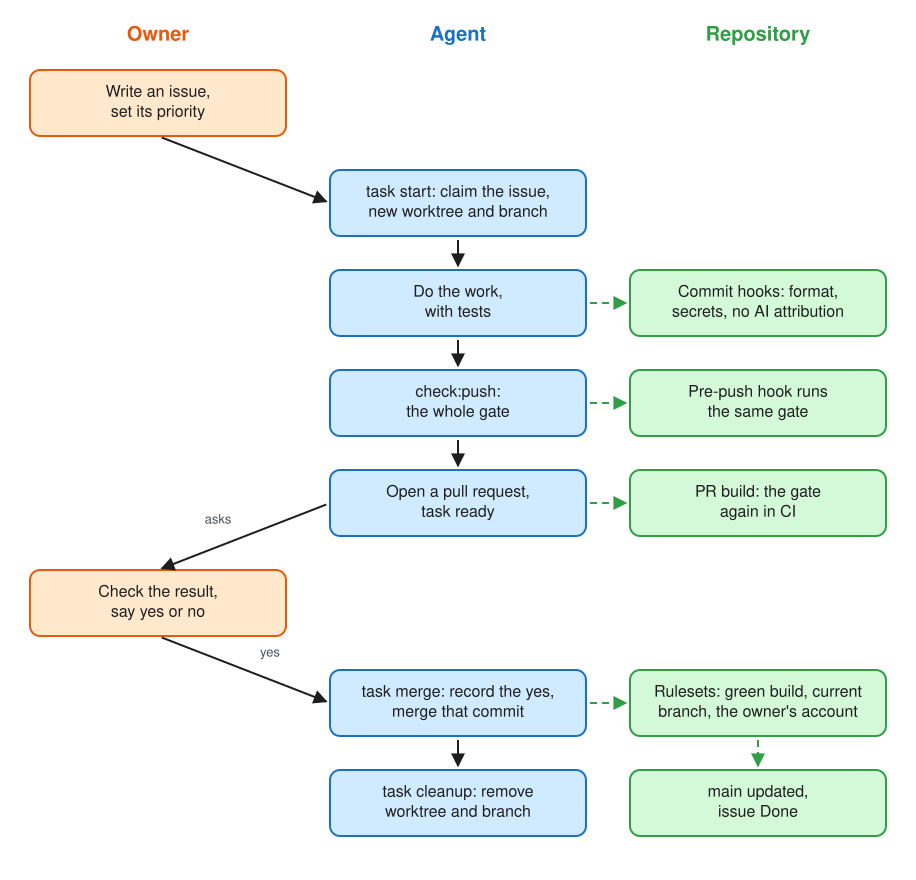
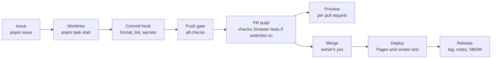

# agentic-starter-ts

A repository template for agent-driven TypeScript development. A repository created from it is independent of the template and starts with defined workflows and working gates, whichever agent does the work: GitHub Copilot, Codex, Claude Code, Gemini CLI, Pi, Hermes Agent or another that reads `AGENTS.md`.

New to working with agents? Do the setup below, then read [getting started with agentic work](engineering/getting-started.md): a first session step by step, how to write an issue an agent can finish, and what to check before you allow a merge.



## What a new repository gets



| Area          | What you get                                                                                                                                                           | Kept by                                             |
| ------------- | ---------------------------------------------------------------------------------------------------------------------------------------------------------------------- | --------------------------------------------------- |
| Agent rules   | One instruction file for every agent; a guardrail table where each rule names its mechanism                                                                            | `check:agents`                                      |
| Agent safety  | Text an agent reads is data, not orders; Claude Code denied `.env` files and shell fetches                                                                             | `.claude/settings.json`, `AGENTS.md`                |
| Planning      | Issue templates, labels, a Project with Status and Priority, at most four tasks In progress                                                                            | `pnpm issue`, `setup:github`                        |
| Task flow     | One worktree per task, handoffs for unfinished work, cleanup after the merge                                                                                           | `pnpm task`                                         |
| Checks        | Format, lint with types and security rules, types, unused code, secrets, workflow validity and security, links, dependency licences, unit tests, coverage, bundle size | Push hook and `PR build`, one shared list           |
| Browser tests | Playwright and axe against the build; verified local GPU in Chromium, functional Firefox/WebKit checks; optional PR CI and testing farm                                | `pnpm test:browser`, `PR build`, `browser-farm.yml` |
| Merge         | A green `PR build` on a current base and the owner's authorization for the exact commit                                                                                | Rulesets, `pnpm task merge`                         |
| Previews      | Each pull request at its own URL; the publishing key never reaches pull-request code                                                                                   | `pr-preview.yml`, `setup:previews`                  |
| Deploy        | Every merge to GitHub Pages, tested after the deploy; rollback to any commit of `main`                                                                                 | `deploy.yml`, `github-pages` environment            |
| Releases      | Version tags on `main` with generated notes, the build, an SBOM and checksums; immutable tags                                                                          | `pnpm release`, `release.yml`, rulesets             |
| Dependencies  | Weekly audit, Dependabot with a one-week cooldown                                                                                                                      | `dependency-audit.yml`, `dependabot.yml`            |
| Application   | React 19 with Vite and TypeScript: one component, its unit test and a browser test                                                                                     | Replace it with yours                               |

In more detail:

- **One instruction source.** [AGENTS.md](AGENTS.md) holds the rules and the work sequence. GitHub Copilot, Codex, Pi and Hermes Agent read it directly; `.github/copilot-instructions.md`, `CLAUDE.md` for Claude Code and `.gemini/settings.json` for Gemini CLI only point to it, and a check keeps them that way.
- **Guardrails tied to mechanisms.** Each rule in the guardrail table names the hook, script or ruleset that enforces it, or is marked Review-only. A check rejects a row whose script or file does not exist.
- **Safer defaults for agents.** Text an agent reads is data, not instructions; GitHub Copilot's agent gets a prepared environment; a committed deny-only file keeps Claude Code away from `.env` files and denies it `curl` and `wget`.
- **One gate, run twice.** The pre-push hook and the `PR build` workflow run the same list: format, lint, types, unused code, secrets, workflow validity and security, agent entry points, Markdown links, dependency licences, hooks, unit tests, the production build and its size budget. The hook first refuses a working tree that differs from the pushed commit, and any pushed branch or new tag that points at another commit than the one checked out.
- **Commands for the repeatable steps.** `pnpm task` starts a task in its own worktree, checks a pull request, merges with the authorization recorded and cleans up; `pnpm issue` creates and updates issues with complete metadata. Agents do not reinvent these steps each time.
- **A defined issue flow.** Templates for epics and tasks, labels and a Project with Status and Priority; see [the issue tracker](engineering/agents/issue-tracker.md).
- **The owner as the merge gate.** A merge needs a green `PR build` on a current base and the owner's authorization, recorded against the exact commit.
- **Shared work without collisions.** One worktree per task, a handoff for unfinished work and a cleanup procedure after each merge; see [the task lifecycle](engineering/agents/task-lifecycle.md).
- **CI minutes kept low.** The push hook fails a push before CI does, extra browsers and devices are tested locally and reported on the pull request, and every job has a timeout; [CI minutes](engineering/operations/ci-minutes.md) lists what each run costs and the options for a growing project.
- **Tests at two levels.** Unit tests with Vitest in the gate, and browser tests with Playwright on the developer's machine, on its GPU, reported in the pull request; the `PR build` runs them too when the repository variable `BROWSER_TESTS_IN_CI` is `true`. The same tests run locally in Firefox, WebKit and phone emulation, and, optionally, on a testing farm's browsers and real phones from one secret; no provider is built in. See [browser testing](engineering/agents/browser-testing.md).
- **Deploy after every merge.** `main` deploys to GitHub Pages through an environment only `main` may use, the browser tests run against the deployed site, and a manual run rolls back to an earlier commit. Each pull request gets a preview built by its PR build; see [deployment](engineering/operations/deployment.md).
- **Releases from `main`.** `pnpm release` tags the head of `main` with the owner's authorization; CI runs the gate and the complete required Chromium root/nested smoke suite against the tagged build before packaging it with notes grouped by label, the build archive, an SBOM and checksums. Release tags cannot be moved or deleted; see [releases](engineering/operations/releases.md).
- **A minimal application.** React 19 with Vite and TypeScript: one component with a name field, a unit test that renders it without a browser, and a browser test that types into it, so every check has something real to run against. Lint includes the rules of hooks and JSX accessibility rules. A library or an application without React removes it as described in [Without React](#without-react).

Why each of these exists: [problems in agentic work](engineering/agents/agentic-problems.md) lists what goes wrong with coding agents in practice, such as two agents changing one checkout, a merge nobody approved or a green local run that fails in CI, and what here handles each.

## Prerequisites

- **Node.js 24**, **Git** and **pnpm 12**. The pnpm version is pinned in `packageManager` in `package.json`; install it with `npm install --global pnpm@12.10.1`. Node.js 24 still ships Corepack, so `corepack enable` works too.
- **Linux or macOS for the complete repository gate.** On Windows use WSL for that gate; the workflow check has no Windows build. Browser/GPU commands also run natively on Windows.
- **The GitHub CLI**, signed in as an account with administrator rights on the new repository and with the Project scope: `gh auth login`, then `gh auth refresh -s project`.
- **A GitHub plan with rulesets for the repository.** Public repositories have them on every plan; private ones need a paid plan. Without rulesets nothing on GitHub protects `main`, and the merge rule is kept by discipline only.
- **Network access** on the first gate run, which downloads two pinned tools, actionlint and zizmor.

## Start a new repository

The order matters: step 6 protects `main`, so everything before it is pushed directly, and everything after it goes through a pull request.

1. **Create the repository.** On GitHub choose **Use this template** and then clone the new repository, or do both with `gh repo create <owner>/<name> --template SaschaBrunnerCH/agentic-starter-ts --private --clone`. Do not copy the files instead: the dependency check compares with `origin/main`, which a repository created from the template has from its first commit.
2. **Install:** `pnpm install --frozen-lockfile`. This also activates the Git hooks.
3. **Run the gate once:** `pnpm check:push`. It passes without edits.
4. **Make it yours.** Set the owner in `.github/CODEOWNERS`: a user account, or for an organisation a team such as `@org/team`, since an organisation name alone is not valid there. Set the name in `package.json`; `pnpm-lock.yaml` does not record it. Set the title and description in `index.html`. For a library, or an application without React, remove React first; see [Without React](#without-react). Replace the `area:*` labels in `scripts/setup-github.ts` and in [triage labels](engineering/agents/triage-labels.md) with the product's areas. Add the product's terms to [CONTEXT.md](CONTEXT.md). Keep this README until you have finished step 9, then replace it with the product's own.
5. **Commit and push to `main`:** `git commit -am "Start <name> from agentic-starter-ts"` and `git push`. This is the only direct push to `main` the repository will see. The deploy it starts fails, since GitHub Pages is switched on only in step 6; rerun it after step 6 with `gh run rerun --failed $(gh run list --workflow deploy.yml --limit 1 --json databaseId --jq '.[0].databaseId')`.
6. **Set up GitHub:** `pnpm setup:github`. It creates the labels, the Project with its fields and views, squash-only merging, the three rulesets, immutable releases and GitHub Pages, and reports what it changed. A second run reports "No changes." If it reports something as not applied, follow [the hosted settings](engineering/operations/github-hosted-settings.md). For a preview of every pull request, also run `pnpm setup:previews`; it creates a second repository for them, see [deployment](engineering/operations/deployment.md#pull-request-previews).
7. **Finish in the GitHub UI.** Two settings are not covered by the script: switching off the Project's automatic Status workflows and sorting the Ready view by Priority. The hosted-settings page says where.
8. **Create the first epic and task.** Every issue needs a parent that leads to an epic, so start with one. Write the epic's requirements with the sections of the [Epic template](.github/ISSUE_TEMPLATE/epic.md), on GitHub's "New issue" page or in a file passed with `--body-file`:

   ```sh
   pnpm issue create --title "Epic: <first outcome>" --label epic --label area:app --body "<goal and constraints>"
   pnpm issue create --title "<first task>" --label enhancement --label area:app --label ready-for-agent \
     --body-file <file> --parent <epic> --status Ready --priority P1
   ```

   GitHub lists a new Project's items only after about half an hour: until then, `pnpm issue ready` and `pnpm issue wip` show nothing, and the limit of four issues In progress is not checked, while `pnpm issue show` already reports each issue's Status. Start the first task by its number.

9. **Start working.** Give an agent the task, for example "work on issue #2", or follow "How to work here" in [AGENTS.md](AGENTS.md) yourself.

### Without React

The application uses React. A library such as an SDK, or an application with another framework, removes it before the first commit:

1. `pnpm remove react react-dom @vitejs/plugin-react @types/react @types/react-dom`
2. Delete `src/App.tsx` and `src/App.test.tsx`, rename `src/main.tsx` to `src/main.ts` and write it without JSX; point `index.html`, `vite.config.ts` (the coverage exclusion) at the new name.
3. Remove `react()` and its import from `vite.config.ts`, `"jsx"` from `tsconfig.app.json`, and `react`, `jsx-a11y` and the `react/*` rules from `.oxlintrc.json`.
4. Rewrite `e2e/smoke.spec.ts` for the new page; it checks the React heading and name field, and runs in `pnpm test:browser` (and in the PR build when its browser tests are switched on), not in the gate.
5. Run `pnpm check:push` and `pnpm test:browser`; `check:unused` names anything left over.

## Working with an agent

The agent reads `AGENTS.md` on its own. [Getting started with agentic work](engineering/getting-started.md) walks through a first session. What remains for you as the owner:

- **Decide.** Issues labelled `decision-needed` wait for your answer; the Decisions view of the Project lists them.
- **Prioritize.** Set Priority on Ready issues. Agents take the highest one.
- **Authorize merges.** The agent shows you a ready pull request with a green build and asks. Your "yes" is for that commit only; a new commit needs a new one. If the agent works with your GitHub account, GitHub cannot tell it from you: read what it shows you before you answer.
- **Handle what only you can.** Issues labelled `ready-for-human`, the GitHub UI settings in step 7, and merges when the agent has no access to your account.
- **Look at Dependabot weekly.** Its pull requests are handled like any other; see [dependency automation](engineering/agents/dependency-automation.md).

## Commands

To build and test on this machine, run `pnpm test:devices --project chromium`.
Use `pnpm test:devices --help` for other engines and phones/tablets, or
`pnpm browser:doctor --help` for local GPU setup. These browser commands use the same
entrypoints on Windows, WSL, Linux and macOS; see [browser testing](engineering/agents/browser-testing.md).

| Command               | Use                                                                                                                      |
| --------------------- | ------------------------------------------------------------------------------------------------------------------------ |
| `pnpm dev`            | Serve the application locally                                                                                            |
| `pnpm build`          | Build for production into `dist/`                                                                                        |
| `pnpm test`           | Run unit tests with the coverage floor                                                                                   |
| `pnpm test:browser`   | Run browser tests against the production build, on the GPU; see [browser testing](engineering/agents/browser-testing.md) |
| `pnpm test:devices`   | Run them on other browsers and farm devices locally; `--report <pr>` posts the results on the pull request               |
| `pnpm check:push`     | Run the whole gate, as the pre-push hook and the PR build do                                                             |
| `pnpm format`         | Format all files                                                                                                         |
| `pnpm issue help`     | Create, show, claim and update issues in the Project                                                                     |
| `pnpm task help`      | Start a task, check a pull request, merge with recorded authorization, clean up                                          |
| `pnpm setup:github`   | Create or repair labels, Project, merge settings and rulesets                                                            |
| `pnpm release <v>`    | Check a release of the head of `main`; tag it with `--authorized-by-owner`                                               |
| `pnpm setup:previews` | Create the previews repository, its deploy key, environment and variables                                                |

Engineering documentation starts at [engineering/README.md](engineering/README.md).

The template is under the [MIT licence](LICENSE). A repository created from it starts with that file: keep it, or choose another licence for your own code before making the repository public, keeping the template's copyright notice with the parts you keep. AI-assisted contributions are contributed under the repository's licence, as `CONTRIBUTING.md` states.
