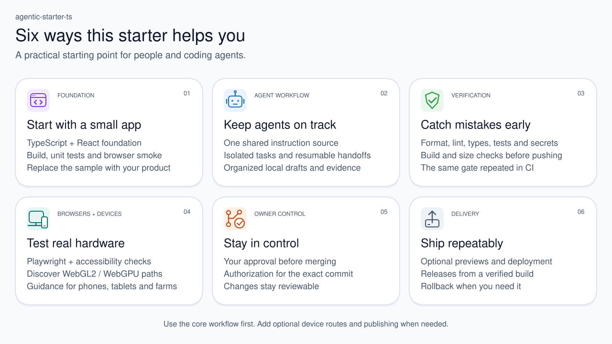
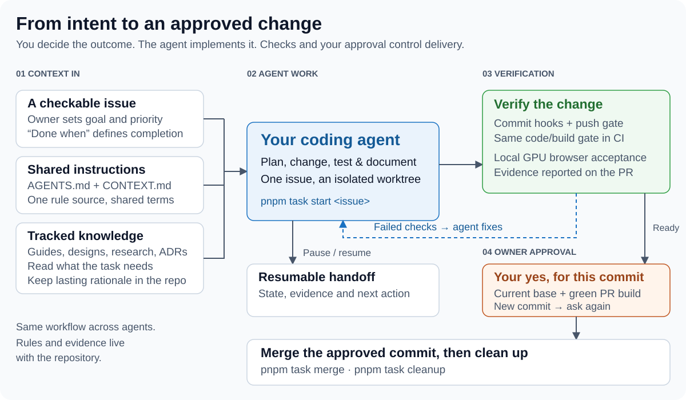
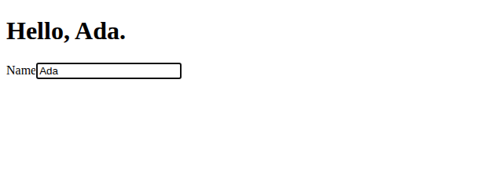
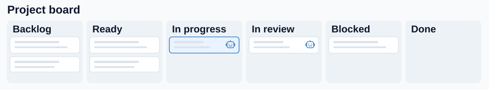
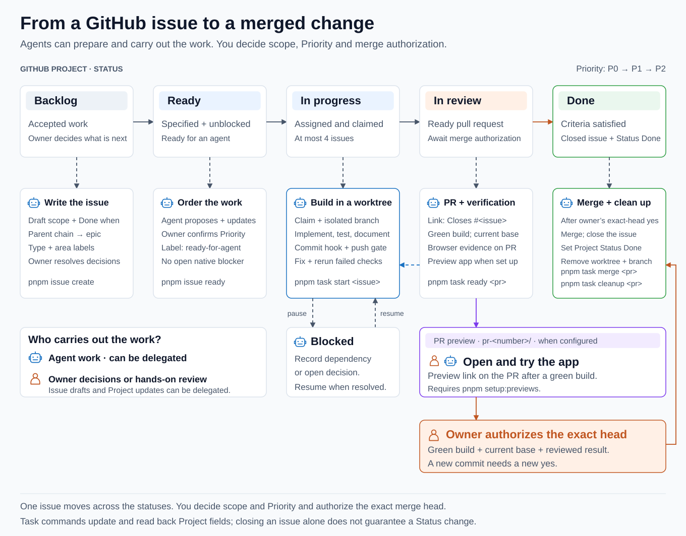

# agentic-starter-ts

A repository template for agent-driven TypeScript development, including graphics applications. The replaceable example draws a blueprint world with native WebGL2 and WebGPU. A repository created from it is independent of the template and starts with defined workflows and working gates, whichever agent does the work: GitHub Copilot, Codex, Claude Code, Gemini CLI, Pi, Hermes Agent or another that reads `AGENTS.md`.

## Six highlights

- **Start with a small app.** React, TypeScript and Vite, with an editable greeting, native WebGL2/WebGPU globe and flat-map examples, and unit/browser tests; [adapt it to your project](#start-a-new-repository).
- **Keep agents on track.** One [instruction source](AGENTS.md), checkable issues, isolated worktrees and resumable handoffs.
- **Catch mistakes early.** The same [verification gate](engineering/agents/local-verification.md) runs locally before pushing and in the PR build.
- **Test real hardware.** [Playwright browser tests](engineering/agents/browser-testing.md), GPU discovery and optional desktop, phone, tablet and farm coverage, with evidence that distinguishes actual hardware from emulation.
- **Stay in control.** A current branch, green PR build and your authorization for the exact commit before [merging](engineering/agents/task-lifecycle.md#validate-and-complete).
- **Ship repeatably.** [PR previews and deployment](engineering/operations/deployment.md), tested releases, immutable tags and rollback by commit.

New to working with agents? Complete setup below, then follow [your first session](engineering/getting-started.md). The [engineering index](engineering/README.md) gives the reading order and specialist guides.

<picture>
  <source media="(max-width: 600px)" srcset="engineering/diagrams/template-highlights-narrow.svg">
  
</picture>

## How the agent workflow fits together

You define the outcome and authorize the merge. The agent takes one checkable issue through implementation, verification and a pull request, using the same workflow whichever coding agent you choose.

Robot icons mark work an agent can carry out or receive by delegation. Person icons mark owner decisions or hands-on review. You can delegate issue drafting and Project updates while deciding the scope, Priority and authorization to merge.

**Local workloads take turns.** Test suites, builds, browser acceptance and complete verification gates share the machine across agent sessions and repositories. Overlapping runs can lengthen runtimes, exhaust memory and cause timeouts that look like regressions. [Local workload coordination](engineering/agents/workload-coordination.md) reserves one shared slot for participating commands while planning, reading and editing continue concurrently. A gate retains that reservation through its nested tests and build. GitHub CI runs separately; activity outside participation still needs host-load inspection.

<picture>
  <source media="(max-width: 600px)" srcset="engineering/diagrams/agent-workflow-narrow.svg">
  
</picture>

- **Context in.** The [issue](engineering/agents/issue-tracker.md) supplies the goal, priority and “Done when” criteria. [AGENTS.md](AGENTS.md) supplies the rules; [CONTEXT.md](CONTEXT.md) supplies shared terms. The agent reads guides, designs, research and ADRs as the task needs them, and preserves lasting findings and rationale in tracked records. The repository's [review and issue skills](engineering/agents/ai-tools.md#skills) start only when a person names them. A [handoff](engineering/agents/task-lifecycle.md#handoff-with-unfinished-work) records state, evidence and the next action for unfinished work.
- **Agent work.** `pnpm task start <issue>` claims the issue and creates an isolated branch and worktree. The agent plans, implements, tests and updates documentation. An optional, owner-requested [independent review](engineering/agents/review.md) reads the rules, issue and diff in a fresh context, reports findings and leaves fixes to the author.
- **Guardrails out.** Commit hooks check formatting, staged lint and secrets. `pnpm check:push` checks types, lint, unit tests and coverage, links, licences, secrets, workflows, the production build and its size budget; the PR build repeats the code/build gate. When [PR previews are configured](engineering/operations/deployment.md#pull-request-previews), a successful build publishes an app preview linked from the PR: open it and try the change. Local Chrome/GPU acceptance with axe is reported on the PR separately. Failed checks return to the agent for fixes; `pnpm task ready <pr>` checks the head, base and PR build. See [the full gate and its evidence](engineering/agents/local-verification.md).
- **Human gates.** You resolve product decisions and review the ready pull request. With a current base and green PR build, you authorize the exact commit. A new commit needs a new yes. An independent review adds evidence for your decision. The agent then merges the approved commit and cleans up its worktree and branch through the [task lifecycle](engineering/agents/task-lifecycle.md#validate-and-complete).

## Start a new repository

Follow [project setup](engineering/setup.md) for prerequisites, Windows/WSL setup, repository personalization, hosted settings and example replacement. That guide remains available after you replace this README with the product's own.

### Example application

The one-page example keeps the greeting above two matching blueprint canvases. Globe and Flat map control both panels; globe rotation is optional and starts paused for reduced motion. Each panel explains unavailable APIs and links to [WebGL2 Report](https://webglreport.com/?v=2) or [WebGPU Report](https://webgpureport.org). It uses original schematic outlines, no map service, textures, graphics library or added runtime dependency. It is not a cartographic product or performance benchmark.

The [capture metadata and procedure](engineering/diagrams/README.md#actual-ui-capture) identify what was actually rendered. The [example design](engineering/designs/blueprint-graphics-example.md) explains its code and evidence limits.

The native APIs are separate: [WebGL2 setup and drawing](src/graphics/webgl-renderer.ts) and [WebGPU setup and drawing](src/graphics/webgpu-renderer.ts). Their shaders live in [GLSL vertex](src/graphics/shaders/world.vert.glsl), [GLSL fragment](src/graphics/shaders/world.frag.glsl) and [WGSL](src/graphics/shaders/world.wgsl) files; the small [renderer contract](src/graphics/renderer.ts) is shared.

## Working with an agent

The agent reads `AGENTS.md` on its own. [Getting started with agentic work](engineering/getting-started.md) walks through a first session. What remains for you as the owner:

- **Decide.** Issues labelled `decision-needed` wait for your answer; the Decisions view of the Project lists them.
- **Prioritize.** Set Priority on Ready issues. Agents take the highest one.
- **Authorize merges.** The agent shows you a ready pull request with a green build and asks. Your "yes" is for that commit only; a new commit needs a new one. If the agent works with your GitHub account, GitHub cannot tell it from you: read what it shows you before you answer.
- **Handle what only you can.** Issues labelled `ready-for-human`, the GitHub UI settings in step 7, and merges when the agent has no access to your account.
- **Look at Dependabot weekly.** Its pull requests are handled like any other; see [dependency automation](engineering/agents/dependency-automation.md).

### Through GitHub Issues, Projects and pull requests

The [GitHub workflow](engineering/agents/issue-tracker.md) connects the issue, the Project and the pull request. One task moves through **Backlog → Ready → In progress → In review → Done**; **Blocked** records a dependency or decision that stops started work.

The Project's **Board** view groups open issues by Status. The cards below use muted lines as placeholders so the process stays in focus. Closed tasks disappear from this open-only view; the workflow below shows how a task reaches Done.

<picture>
  <source media="(max-width: 900px)" srcset="engineering/diagrams/project-board-narrow.svg">
  
</picture>

The workflow below shows the steps that move an issue through the board, including the PR preview you can try before authorizing a merge.

<picture>
  <source media="(max-width: 600px)" srcset="engineering/diagrams/github-workflow-narrow.svg">
  
</picture>

- **Issues define the work.** An agent can draft an issue from your goal, including a parent chain to an epic, type and area labels, and checkable “Done when” criteria. You resolve product decisions. Ready work is specified and unblocked; `ready-for-agent` identifies work an agent can take.
- **Projects track execution.** An agent can propose ordering and apply your decisions to Project fields. You decide Priority: P0, then P1, then P2. `pnpm task start <issue>` claims the task, sets In progress and creates its worktree. At most four issues are In progress. A blocked task records what it needs and resumes when that is resolved.
- **Pull requests deliver the change.** The agent opens a PR linking its issue with `Closes #<issue>` and reports checks and browser evidence. Failed checks return to the agent for fixes. After a green PR build, configured previews publish the app and link it in a PR comment: you and the agent can open it and try the change before merge. Enable this once with `pnpm setup:previews`; see [PR preview setup](engineering/operations/deployment.md#pull-request-previews). `pnpm task ready <pr>` verifies readiness and sets In review. Your yes authorizes the exact head; the agent runs `pnpm task merge` to merge it, close the issue and set Done, then `pnpm task cleanup` removes the local worktree and branch. The commands update and read back Project fields; closing an issue alone does not guarantee its Status changes.

## Commands

To build and test on this machine, run `pnpm test:devices --project chromium`.
Use `pnpm test:devices --help` for other engines and phones/tablets, or
`pnpm browser:doctor --help` for local GPU setup. These browser commands use the same
entrypoints on Windows, WSL, Linux and macOS; see [browser testing](engineering/agents/browser-testing.md).

| Command                | Use                                                                                                                           |
| ---------------------- | ----------------------------------------------------------------------------------------------------------------------------- |
| `pnpm dev`             | Serve the application locally                                                                                                 |
| `pnpm build`           | Build for production into `dist/`                                                                                             |
| `pnpm test`            | Run unit tests with the coverage floor                                                                                        |
| `pnpm test:browser`    | Run browser tests against the production build, on the GPU; see [browser testing](engineering/agents/browser-testing.md)      |
| `pnpm test:devices`    | Run them on other browsers and farm devices locally; `--report <pr>` posts the results on the pull request                    |
| `pnpm workload status` | Inspect advisory ownership of the shared local workload slot; see [coordination](engineering/agents/workload-coordination.md) |
| `pnpm check:push`      | Run the whole gate, as the pre-push hook and the PR build do                                                                  |
| `pnpm format`          | Format all files                                                                                                              |
| `pnpm issue help`      | Create, show, claim and update issues in the Project                                                                          |
| `pnpm task help`       | Start a task, check a pull request, merge with recorded authorization, clean up                                               |
| `pnpm setup:github`    | Create or repair labels, Project, merge settings and rulesets                                                                 |
| `pnpm release <v>`     | Check a release of the head of `main`; tag it with `--authorized-by-owner`                                                    |
| `pnpm setup:previews`  | Create the previews repository, its deploy key, environment and variables                                                     |

Engineering documentation starts at [engineering/README.md](engineering/README.md).

The template is under the [MIT licence](LICENSE). A repository created from it starts with that file: keep it, or choose another licence for your own code before making the repository public, keeping the template's copyright notice with the parts you keep. AI-assisted contributions are contributed under the repository's licence, as `CONTRIBUTING.md` states.
