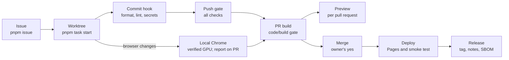

# Engineering

Contributor documentation: how work is planned, done, verified and merged. Product usage documentation does not belong here.

## Read first

After the [repository setup](../README.md#start-a-new-repository):

1. [Getting started](getting-started.md): follow a first session and learn what to review before a merge.
2. [Task lifecycle](agents/task-lifecycle.md) and [working style](agents/working-style.md): start isolated work, keep changes focused and leave a handoff.
3. [Local verification](agents/local-verification.md): understand the gate and the evidence it provides.

When investigating a question or proposing a decision, use [knowledge ownership](agents/decision-workflow.md#knowledge-ownership) to choose its tracked home and review its portability.

Consult the guides below when their topic applies. For browser changes, start with [browser testing](agents/browser-testing.md), then GPU discovery or device coverage as needed.

## Reference

| Page                                                           | Covers                                                                       |
| -------------------------------------------------------------- | ---------------------------------------------------------------------------- |
| [Getting started with agentic work](getting-started.md)        | A first session for people new to this way of working                        |
| [Problems in agentic work](agents/agentic-problems.md)         | What goes wrong with agents and what handles each problem                    |
| [Task lifecycle](agents/task-lifecycle.md)                     | Starting, resuming, completing and handing off a task                        |
| [Decision workflow](agents/decision-workflow.md)               | Goal to merge, knowledge ownership and portability review                    |
| [Working style](agents/working-style.md)                       | How much to change, how to write, local-only work                            |
| [Engineering scripts](../scripts/README.md)                    | Tooling responsibilities, command entry points and lifecycle                 |
| [Issue tracker](agents/issue-tracker.md)                       | Issue metadata, the Project's statuses and priorities                        |
| [Triage labels](agents/triage-labels.md)                       | Label vocabulary                                                             |
| [Local verification](agents/local-verification.md)             | What runs at commit, at push and in CI                                       |
| [Review by a second agent](agents/review.md)                   | When to ask for one, how to brief it, what it establishes                    |
| [Browser testing](agents/browser-testing.md)                   | Local GPU acceptance and explicitly requested wider coverage                 |
| [Browser GPU discovery](agents/browser-gpu-discovery.md)       | Find and verify a hardware launch profile across operating systems           |
| [Device coverage](agents/browser-device-coverage.md)           | Matrix, tablet emulation, wired/wireless phones and tablets, farm limits     |
| [Dependency automation](agents/dependency-automation.md)       | Dependabot and the weekly audit                                              |
| [Dependency-direction rules](agents/dependency-rules.md)       | When to add rules about which code may import which, and how to enforce them |
| [Deployment](operations/deployment.md)                         | Deploy to Pages, the test after it, rollback, other targets                  |
| [Releases](operations/releases.md)                             | Version tags, release assets, notes                                          |
| [CI minutes](operations/ci-minutes.md)                         | What runs cost and how to keep them low                                      |
| [Threat model](security/threat-model.md)                       | What could go wrong and what stops it                                        |
| [Data handling](agents/data-handling.md)                       | Data classes and what may appear where                                       |
| [AI tools](agents/ai-tools.md)                                 | Approved agents, MCP servers, provider changes                               |
| [AI incidents](operations/ai-incidents.md)                     | What counts, what to do, closing the gap                                     |
| [GitHub hosted settings](operations/github-hosted-settings.md) | Rulesets, labels and Project that live outside the files                     |
| [Visual documentation](diagrams/README.md)                     | Choosing formats, editable examples, charts, screenshots and maintenance     |
| [ADRs](adr/README.md)                                          | Architecture Decision Records                                                |
| [Research records](research/README.md)                         | Results of investigations, kept with their tested revision                   |
| [Design notes](designs/README.md)                              | Options and recommendations before a decision                                |
