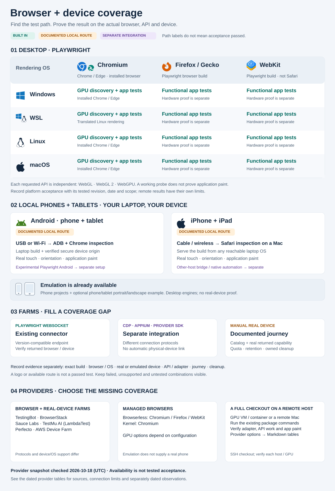

# Browser and device coverage

Start with `pnpm test:devices --project chromium`: build and test on this machine.
The package commands work in PowerShell, cmd and POSIX shells. Install the chosen
Playwright browsers and an installed Chrome, Chromium or Edge for hardware
discovery; `pnpm browser:doctor --help` explains prerequisites. Select only the
APIs the application uses, as the [GPU guide](browser-gpu-discovery.md) describes.

[](../diagrams/browser-device-matrix.svg)

Open the graphic for full size. Built-in, documented and separate-integration
labels describe possible paths; record actual test results separately using the
[evidence format](#record-actual-evidence). The table below is its text counterpart;
the [provider comparison](#provider-comparison) helps choose remote coverage.

## Declare the supported matrix

Describe supported combinations explicitly. A useful row contains browser and
engine/version, rendering OS/version, device or viewport, required graphics API,
input/scenario and evidence status. Record the test-driver OS separately: WSL
controlling a Windows browser is a Windows browser result, while a Linux browser
in WSL is translated Linux rendering. Neither is a native Linux workstation run.

| Target                      | Windows, WSL, Linux and macOS paths                                        | Evidence and limits                                                                                                                  |
| --------------------------- | -------------------------------------------------------------------------- | ------------------------------------------------------------------------------------------------------------------------------------ |
| Chromium, Chrome or Edge    | `chromium`; installed browser discovery for required GPU runs              | Chromium engine. Chrome/Edge distribution, policies and codecs can differ; discovery choosing Chrome does not test Edge too.         |
| Firefox / Gecko             | `firefox`, using Playwright's patched Firefox build                        | Functional engine coverage. Shipping Firefox and its graphics adapter need their own acceptance.                                     |
| Playwright WebKit           | `webkit`, using the OS-specific Playwright build                           | Functional WebKit coverage. It is not shipping Safari, and Linux WebKit does not establish macOS/iOS coverage.                       |
| Shipping Safari             | macOS Safari; Safari on an actual iPhone/iPad                              | Check on that OS/device by hand or through a separately supported automation path. No built-in Safari connection.                    |
| Phone emulation             | `mobile-chrome` (Pixel 7); `mobile-safari` (iPhone 15) on the developer OS | Desktop engines with viewport, touch and user-agent settings. Only phone Chromium shares local GPU verification.                     |
| Tablet emulation            | Optional descriptor example below, on the developer OS                     | Portrait/landscape layout and emulated touch; no physical-tablet or mobile performance claim.                                        |
| Real Android phones/tablets | Chrome inspection through USB/Wi-Fi; device opens a reachable build        | Browser executes on Android. Another Android browser needs its own supported interface and engine checks.                            |
| Real iPhone/iPad            | Reachable build from any host; standard Safari inspection from a Mac       | Browser executes on iOS/iPadOS. Record its actual browser/engine rather than inferring it from a desktop browser's name.             |
| Containers, VMs and farms   | Browser host may differ from the driver host; provider-specific connection | Record physical device, simulator, emulator, virtual GPU or software renderer separately. Remote availability is not GPU acceptance. |

The configured inventory remains Chromium, Firefox, WebKit, phone Chromium and
phone WebKit; the starter adds no tablet project or provider adapter.
[Playwright's browser documentation](https://playwright.dev/docs/browsers)
explains distribution and OS differences. Native ChromeOS, embedded views or
other environments belong in a derived application's matrix when it supports
them; the starter does not claim their verification.

Choose representative phone/tablet sizes, portrait/landscape, DPR and relevant
mouse, keyboard, touch or pen journeys. Include zoom, reduced motion, network
conditions, media and assistive technology when the application depends on them.
An emulated tap or JavaScript-injected gesture does not establish native multitouch,
TalkBack, VoiceOver or keyboard usability. Test those declared combinations on
the actual browser/device with the required input or assistive tool.

Keep [focused PR acceptance](browser-testing.md#as-the-suite-grows) and the full
declared inventory at enforced release verification. Do not form a Cartesian
product of every engine, OS, device, API and scenario. Keep unavailable rows
visible as **unverified**, with the missing machine/tool or failure reason.
The starter's enforced release smoke remains Chromium at root/nested paths; it
does not enforce a derived application's complete supported matrix.

## Install and launch on Windows and WSL separately

Use native Windows Node.js/pnpm in a Windows checkout for Windows browser results,
and Linux Node.js/pnpm in a WSL checkout for WSL results. Check `node -p "process.platform"`:
expect `win32` or `linux`, respectively. Install dependencies in each checkout;
do not reuse the other platform's `node_modules` or downloaded browser binaries.
The [shared browser cache](browser-testing.md#on-your-machine) separates platforms
automatically. Microsoft's [filesystem guidance](https://learn.microsoft.com/en-us/windows/wsl/filesystems)
explains why a Windows-drive checkout suits Windows tools and a Linux-filesystem
checkout suits Linux tools.

After installing the [repository prerequisites](../setup.md#prerequisites),
run in each environment:

```sh
pnpm install --frozen-lockfile
pnpm test:browser:install
pnpm browser:cli install firefox
pnpm browser:check firefox
pnpm build
```

The install command supplies bundled Chromium; verified GPU discovery also needs
an installed Chrome, Chromium or Edge. Use `pnpm test:browser` for routine local
Chromium GPU acceptance, or `pnpm test:devices --project firefox` for functional
Firefox coverage. Follow the [GPU guide](browser-gpu-discovery.md) for API requirements.
Everyday development and the full repository gate run in WSL2 on Windows; see [WSL2 setup](../setup.md#windows-development-with-wsl2). The separate Windows checkout described here supports explicit native browser acceptance. These setup commands do not add
visible or parallel runs to routine acceptance.

If Node/pnpm or a PowerShell launcher fails before Playwright starts, repair that
host's tool installation first. For layout checks, use Playwright's supported
[viewport settings](https://playwright.dev/docs/emulation#viewport); arbitrary
browser startup arguments can be interpreted as URLs. Successful installation
does not establish that the application's browser tests or graphics output pass.

## Reach a real device from a laptop

Use an available local phone or tablet as a first-class acceptance target. Follow
the cable or wireless recipe below, then rotate the device, use real finger
gestures and the on-screen keyboard, and check layout, focus, scrolling and the
declared accessibility journey. Verify required WebGL/WebGPU work and the expected
application frame on that device. Record whether input came from a person, native
automation or injected browser events; connectivity and emulated taps do not
establish these physical-device results.

Build first. For a trusted network, `pnpm preview --host 0.0.0.0 --port 4173 --strictPort`
serves the build; open the laptop's reachable address on the device. Verify the
exact build and each host boundary, firewall and asset/API origin. A phone's
`localhost` means that phone. LAN HTTP can check ordinary UI, but secure-context
features such as WebGPU need trusted HTTPS or a verified secure loopback route.
Check `window.isSecureContext` and the requested API on the rendering device;
an ignored certificate warning or desktop adapter is not evidence.

### Android: cable

Use standalone [Platform Tools/ADB](https://developer.android.com/tools/adb) on
Windows, Linux or macOS; an Android Studio installation is optional. Enable
developer options and USB debugging, connect a data cable, unlock the device and
approve its debugging authorization. Windows may need an OEM USB driver; Linux
may need device permissions. Device security features can disable debugging;
follow the manufacturer's instructions, for example
[Samsung Auto Blocker](https://www.samsung.com/ca/support/mobile-devices/protect-your-samsung-galaxy-with-auto-blocker/),
and restore those protections after testing. Choose the intended device from
`adb devices -l`. Replace `SERIAL` below with its identifier, keeping identifiers
out of public logs:

```text
adb -s SERIAL reverse tcp:4173 tcp:4173
```

Open `http://localhost:4173/` in device Chrome. The reverse mapping makes that
device port reach the ADB host's port; verify secure-context/API access there.
On the computer, use Chrome's `chrome://inspect/#devices`, enable USB discovery,
and inspect the intended tab. [Chrome port forwarding](https://developer.chrome.com/docs/devtools/remote-debugging/local-server)
also provides a UI for reaching the laptop server. Site reverse forwarding and
forwarding a DevTools socket to the computer are different operations.

An authorized ADB connection does not prove Chrome is ready for inspection. Keep
the phone unlocked and Chrome open while connecting. Attach to an owned test tab
and preserve existing tabs and browser data; do not reset a personal browser to
make automation connect.

If the project still is not visible, wake and unlock the phone, then explicitly
open Chrome on the intended HTTPS page. The following launch targets the installed
Google Chrome app. Replace `SERIAL` and `HTTPS_TEST_URL`; the latter must be your
reachable test URL:

```text
adb -s SERIAL shell input keyevent KEYCODE_WAKEUP
adb -s SERIAL shell am start -W --user current -n com.android.chrome/com.google.android.apps.chrome.Main -a android.intent.action.VIEW -d HTTPS_TEST_URL --ez create_new_tab true
```

Confirm the page on the physical screen and in the inspector before proceeding;
an accepted launch request alone is insufficient. This Chrome component is not
a launcher for other Android browsers.

With Windows ADB and a WSL server, prove Windows can reach that server first;
reverse forwarding reaches Windows. Keep one ADB host in charge. Alternatively,
explicit [USB attachment to WSL](https://learn.microsoft.com/en-us/windows/wsl/connect-usb)
needs `usbipd-win`; a cable does not expose a device to both hosts automatically.
[WSL networking](https://learn.microsoft.com/en-us/windows/wsl/networking) differs
between NAT and mirrored modes. Do not assume Windows localhost or LAN access
works merely because WSL localhost does.

### Android: wireless

On Android 11+ devices offering wireless debugging, enable it on a trusted shared
network. Follow the current ADB guide for the installed Android/Platform Tools
versions. Pair using `adb pair DEVICE_IP:PAIRING_PORT` and enter the code at its
prompt. If discovery does not connect automatically, use the connection address
shown by the device: `adb connect DEVICE_IP:CONNECTION_PORT`. Pairing and connection
ports can differ; newer ADB Wi-Fi versions also change discovery behavior.
Select that connection with `adb -s SERIAL`, establish the required reverse mapping,
unplug USB, and repeat the page and inspection checks to prove the wireless path.

A scanned pairing QR code is not confirmation of a connection. If discovery
stalls, check the pairing/connection addresses on the phone and use the explicit
commands above. With several network adapters, verify the workstation and device
are on the intended network before changing settings; mDNS discovery can fail
independently of the browser. Until an unplugged browser check succeeds, record
the wireless path as unverified; use a separately verified USB path when available.
One failed pairing attempt does not establish that wireless debugging is unsupported.

After either path, remove only the owned mapping with
`adb -s SERIAL reverse --remove tcp:4173`. For Wi-Fi, `adb disconnect DEVICE_IP:CONNECTION_PORT`
closes that connection; forget the paired workstation in device settings when
appropriate and turn debugging off when finished. Keep addresses and pairing
material local. Avoid killing a shared ADB server or deleting other mappings.

ADB transport does not connect the existing phone-emulation project to hardware.
[Playwright's experimental Android API](https://playwright.dev/docs/api/class-android)
supports a separate Android Chrome/WebView workflow; its prerequisites and
limitations must be checked before adopting it. It is not integrated here.

### iPhone/iPad: cable and wireless

For Apple's standard inspection path, use a Mac, unlock and trust/pair the device,
and enable Web Inspector under **Settings → Apps → Safari → Advanced** (older
versions put Safari directly under Settings). Keep Safari open and the device
unlocked during the check. Enable Safari's developer
features on the Mac, open the intended page on the device and select it from
Safari's Develop menu. [WebKit's inspection guide](https://webkit.org/web-inspector/enabling-web-inspector/)
covers cable inspection and wireless inspection after Xcode device configuration.
For wireless, complete that pairing/configuration, check same-network reachability,
unplug the cable and inspect the page again. Setting names vary with OS versions.

A cable or inspection pairing does not forward the website as Android ADB reverse
does. Use a reachable trusted HTTPS build for secure APIs. Windows/Linux/WSL can
serve that build and the device can browse it; Apple's standard local Safari
inspection workflow requires macOS. Optional third-party
[WebInspector bridges](https://github.com/doronz88/pymobiledevice3/blob/master/docs/guides/webview-debugging.md)
offer other host paths, but need separate version, trust, transport and browser
proof; they are not installed or supported by this starter. Some automation tools
also require **Remote Automation** in Safari's Advanced settings; follow that
tool's prerequisites. JavaScript, screenshots and graphics readback alone do not
establish native touch or keyboard automation. Use a normal Safari tab for the
manual input journey and record it separately. Signed native automation
and provider-specific iOS automation are separate integrations.

#### Optional Windows USB inspection

Follow the bridge's [Windows installation prerequisites](https://github.com/doronz88/pymobiledevice3/blob/master/docs/installation.md)
for Apple's device service and [uv setup](https://docs.astral.sh/uv/getting-started/installation/).
This is separate host tooling, not a repository dependency or built-in Playwright
project. Choose and verify a tool version for the host/device combination before
installing it; replace `<verified-version>` below with that exact version. With the
intended USB device trusted/unlocked and a free loopback port, launch an isolated bridge:

```powershell
uv run --no-project --with "pymobiledevice3==<verified-version>" python -m pymobiledevice3 webinspector cdp --host 127.0.0.1 --port 9222
```

Keep the bridge running and open its loopback landing page in desktop Chrome;
select only the owned test page and keep device/tab listings private. Verify the
protocol and prerequisites against the [bridge guide](https://github.com/doronz88/pymobiledevice3/blob/master/docs/guides/webview-debugging.md).
Keep the intended browser/page in the foreground before attaching. Manual
foregrounding avoids introducing a separate app-switching integration; do not
infer that ordinary inspection requires Developer Mode from another tool's prerequisites.
Chrome on iPad also has its own **Settings → Content Settings → Web Inspector**
switch; enable it and relaunch Chrome, as [Chrome's guide](https://developer.chrome.com/blog/debugging-chrome-on-ios)
describes. Chrome's switch is separate from Safari's.

Verify transport, browser inspection, graphics output and native input separately.
An inspector timeout alone does not establish that Web Inspector is disabled.
For wireless inspection, recheck the browser service after unplugging instead of
inferring support from pairing, an IP address or a successful device-management
query. These instructions do not establish USB or wireless acceptance for a new
host/device combination. Keep any screen-awake override temporary, record its previous value and
restore it before disconnecting. If a device disconnects first, report cleanup
as pending and reconnect to verify restoration; stopping a host helper alone
does not establish that page activity or device settings stopped.

Close owned inspection sessions/tabs, stop the test server, disable wireless
debugging/inspection when finished and unpair where appropriate. Apple's
[trust guidance](https://support.apple.com/en-us/109054) explains revocation;
resetting trust can affect other remembered computers, so choose it deliberately.

## Phone and tablet example without expanding the default projects

Playwright's [device descriptors](https://playwright.dev/docs/emulation) include
phone/tablet portrait/landscape settings. They are emulation presets, not a current
hardware recommendation. To try the starter's input journey, save this optional
example as `.local/emulation-check.mjs` in the checkout:

```js
import assert from "node:assert/strict";
import { devices, webkit } from "@playwright/test";

const browser = await webkit.launch({ headless: true });
try {
  for (const name of [
    "iPhone 15",
    "iPhone 15 landscape",
    "iPad (gen 7)",
    "iPad (gen 7) landscape",
  ]) {
    const device = devices[name];
    assert.ok(device);
    const context = await browser.newContext(device);
    try {
      const page = await context.newPage();
      await page.goto(process.env.BROWSER_TEST_BASE_URL ?? "http://127.0.0.1:4173/");
      const observed = await page.evaluate(() => ({
        width: innerWidth,
        height: innerHeight,
      }));
      assert.equal(observed.width, device.viewport.width);
      assert.equal(observed.height, device.viewport.height);
      const field = page.getByLabel("Name");
      await field.evaluate((element) => {
        element.addEventListener(
          "touchstart",
          (event) => {
            element.setAttribute("data-touch-count", String(event.touches.length));
          },
          { once: true },
        );
      });
      await field.tap();
      assert.equal(await field.getAttribute("data-touch-count"), "1");
      assert.equal(await field.evaluate((element) => element === document.activeElement), true);
      await field.fill("Ada");
      await page.getByRole("heading", { name: "Hello, Ada.", exact: true }).waitFor();
      console.log(`${name}: viewport, emulated touch and input journey passed`);
    } finally {
      await context.close();
    }
  }
} finally {
  await browser.close();
}
```

Install WebKit with `pnpm browser:cli install webkit`, then `pnpm build` and
`pnpm preview --host 127.0.0.1 --port 4173 --strictPort`. In another terminal run
`node --import ./scripts/browser/playwright-browsers-env.ts .local/emulation-check.mjs`. Stop that owned preview afterwards. Follow the
[shared-machine rules](browser-testing.md#what-an-agent-never-does) before this
standalone example; it does not acquire discovery's lock. This is a
functional example, with no GPU assertion. For a derived application, put its
actual layout/touch journey and existing accessibility assertions in its normal
suite; declare any additional projects and release rows deliberately.
The example checks an actual emulated touch event and focus/input behavior;
a descriptor, user-agent string or capability flag alone cannot establish them.

## Record actual evidence

Use the same record for local, physical-device and farm runs:

```text
Build commit + clean/dirty state; tested URL/build identity; date/operator
Driver OS; rendering OS/version; device model or emulation descriptor + orientation/DPR
Requested and observed browser/version/engine; transport and actual input method
Required API; observed adapter/fallback + submitted work/readback; app frame/journey/axe result
Passed / failed / unavailable / unverified rows; retained evidence; owned cleanup result
```

Keep raw device identifiers, addresses, pairing records and authenticated endpoints
private. Capability discovery, connectivity, API work, correct application paint,
native interaction and performance are separate milestones. Use the application's
actual context/adapter, a meaningful expected frame and negative controls for GPU
acceptance, as the [GPU guide](browser-gpu-discovery.md#evidence-and-recovery) requires.
Portable screenshots/axe and provider-native input need their own executed evidence.
Take device OS information from the rendering device or returned device capabilities;
generic provider OS fields may identify a coordinator, and frozen user agents can
misidentify mobile devices. Record the test-driver OS separately. A project's own
platform evidence must identify its tested build; these instructions do not certify
untested machines/devices or confer acceptance from another project's runs.

## Testing farms

A farm can supply a missing browser/OS or real device. Choose its connection path
before selecting a label from its catalog:

| Path                                    | What this starter implements                                       | What still needs verification or separate integration                                                     |
| --------------------------------------- | ------------------------------------------------------------------ | --------------------------------------------------------------------------------------------------------- |
| Compatible Playwright WebSocket         | Existing `test:devices --endpoints`, or the optional farm workflow | Supported Playwright version, actual engine, browser host, network reachability and returned capabilities |
| CDP-only endpoint                       | No general CDP adapter                                             | Chromium connection code; a CDP endpoint is not a Playwright protocol endpoint                            |
| WebDriver/Appium or provider SDK/runner | No adapter                                                         | Shipping Safari, real-device input or other provider paths need their own implementation                  |
| Manual real-device session              | Operator follows the same declared journey                         | Actual device, input, API/paint and cleanup evidence; no automatic Playwright-suite claim                 |

### Provider comparison

**Source review: 2026-10-18 (UTC).** Dates below refer to documentation/catalog
descriptions, not acceptance runs or current availability. Recheck the chosen
provider before adopting it. C = Chromium (Chrome/Edge where offered),
F = Firefox/Gecko, W = Playwright WebKit; shipping Safari is separate.
Provider support does not establish account access, connector compatibility or
GPU acceptance. WSL needs its own host; the test driver's OS is not the browser OS.

| Browser/device farm                                                                                   | Desktop browser hosts and engines                                                                                                                                                | Physical phones/tablets                                                                                                                                                         | Connection and starter fit                                                                                                                                                                                  | Last checked / basis              |
| ----------------------------------------------------------------------------------------------------- | -------------------------------------------------------------------------------------------------------------------------------------------------------------------------------- | ------------------------------------------------------------------------------------------------------------------------------------------------------------------------------- | ----------------------------------------------------------------------------------------------------------------------------------------------------------------------------------------------------------- | --------------------------------- |
| [TestingBot](https://testingbot.com/support/web-automate/playwright)                                  | Windows/Linux C/F; macOS C/F/W                                                                                                                                                   | Android and iPhone/iPad; [physical catalog](https://testingbot.com/support/api/devices) excludes simulators                                                                     | Desktop Playwright endpoint, subject to version checks. Separate [Android API](https://testingbot.com/support/web-automate/playwright/mobile) / [Appium](https://testingbot.com/support/app-automate) setup | 2026-10-18 · docs + live catalogs |
| [BrowserStack](https://www.browserstack.com/docs/automate/playwright/browsers-and-os)                 | Windows/macOS C/F/W, with OS/version restrictions; no Linux desktop catalog row                                                                                                  | Android and iPhone/iPad; [iOS Playwright setup](https://www.browserstack.com/docs/automate/playwright/playwright-ios/nodejs)                                                    | Desktop Playwright endpoint after compatibility checks; mobile SDK/device paths separate                                                                                                                    | 2026-10-18 · docs + live catalog  |
| [Sauce Labs](https://docs.saucelabs.com/web-apps/automated-testing/playwright/)                       | Windows/macOS C/F/W with [limits](https://docs.saucelabs.com/web-apps/automated-testing/playwright/limitations/); Linux client support does not establish a Linux browser target | [Android/iOS phones and tablets](https://docs.saucelabs.com/mobile-apps/automated-testing/appium/real-devices/); virtual devices separate                                       | `saucectl` runner; Appium for real mobile. Neither built in here                                                                                                                                            | 2026-10-18 · docs only            |
| [TestMu AI (formerly LambdaTest)](https://www.lambdatest.com/support/docs/playwright-testing/)        | Windows/macOS C/F/W with [bundle compatibility](https://www.lambdatest.com/support/docs/playwright-bundled-browser-support/); Linux target unverified                            | [Android](https://www.lambdatest.com/support/docs/playwright-android/) and [iPhone/iPad Safari](https://www.lambdatest.com/support/docs/playwright-ios-device/); iOS gated beta | Provider endpoints/Android API. Published mobile ranges exclude this starter's Playwright 1.64                                                                                                              | 2026-10-18 · docs only            |
| [Perfecto](https://help.perfecto.io/perfecto-help/content/Perfecto/automation-testing/playwright.htm) | Windows Chrome/Edge; macOS C/F/W                                                                                                                                                 | Android Chrome/WebView; iOS Safari Playwright beta                                                                                                                              | Separate capabilities/endpoints; source client-version statements differ, so confirm compatibility                                                                                                          | 2026-10-18 · docs only            |
| [AWS Device Farm](https://docs.aws.amazon.com/devicefarm/latest/developerguide/welcome.html)          | [Desktop TestGrid](https://docs.aws.amazon.com/devicefarm/latest/testgrid/techref-support.html): Windows Chrome/Edge/Firefox                                                     | Android/iOS device pools                                                                                                                                                        | Mobile test uploads/Appium; desktop WebDriver. No plain Playwright endpoint assumed                                                                                                                         | 2026-10-18 · docs only            |

Managed browser services provide endpoints rather than physical mobile devices:

| Provider / service                                                  | Browser coverage | GPU / host limits                                                                                                                                                                           | Connection and starter fit                                                           | Last checked / basis |
| ------------------------------------------------------------------- | ---------------- | ------------------------------------------------------------------------------------------------------------------------------------------------------------------------------------------- | ------------------------------------------------------------------------------------ | -------------------- |
| [Browserless](https://docs.browserless.io/overview/connection-urls) | Hosted C/F/W     | [GPU infrastructure](https://docs.browserless.io/enterprise/private-deployment/performance) is a private-deployment option; shared endpoints do not establish GPU access or a full checkout | Playwright-protocol endpoint fits the connector; Chrome CDP needs a separate adapter | 2026-10-18 · docs    |
| [Kernel](https://www.kernel.sh/browsers)                            | Managed Chromium | [GPU browsers use virtual GPUs](https://www.kernel.sh/blog/gpu); configuration/access need verification; no full-checkout acceptance                                                        | Playwright over CDP needs session lifecycle code; no general CDP adapter here        | 2026-10-18 · docs    |

### GPU hosts and remote Macs

These services supply a host for an ordinary SSH checkout and the existing
package commands. Browser/driver installation is the caller's responsibility.
These are documentation-derived options; each project verifies its own chosen
configuration. Compute/CUDA support alone does not establish usable
OpenGL/Vulkan/Metal, WebGPU or correct application paint.

| Provider                                                                                    | Technical options                                                                                                                                                                              | Access and graphics limits                                                                                                                               | Last checked / basis   |
| ------------------------------------------------------------------------------------------- | ---------------------------------------------------------------------------------------------------------------------------------------------------------------------------------------------- | -------------------------------------------------------------------------------------------------------------------------------------------------------- | ---------------------- |
| [Runpod Pods](https://docs.runpod.io/pods/overview)                                         | Linux GPU containers; selectable GPU/image                                                                                                                                                     | SSH checkout; verify the selected graphics drivers and browser APIs. This path supplies no Windows/macOS or physical mobile target                       | 2026-10-18 · docs      |
| [Infomaniak Public Cloud](https://docs.infomaniak.cloud/compute/instances/flavors/)         | NVIDIA L4, A2, T4, L40S and A100 GPU VM flavors, by cluster                                                                                                                                    | Full VM checkout; project GPU enablement and compatible OS/graphics drivers required                                                                     | 2026-10-18 · docs only |
| [Vast.ai](https://docs.vast.ai/guides/instances/connect/ssh)                                | Marketplace GPU instances; configuration varies by offer                                                                                                                                       | SSH checkout; verify container/VM type, device exposure, drivers and networking                                                                          | 2026-10-18 · docs only |
| [Lambda Cloud](https://docs.lambda.ai/public-cloud/on-demand/connecting-instance/)          | Linux GPU instances with compute tooling                                                                                                                                                       | SSH checkout; verify the browser graphics stack separately from CUDA                                                                                     | 2026-10-18 · docs only |
| [Vultr Cloud GPU](https://docs.vultr.com/products/compute/instances/cloud-gpu/provisioning) | GPU VMs with selectable image/configuration                                                                                                                                                    | Full checkout; distinguish dedicated GPU from [vGPU](https://docs.vultr.com/how-to-manage-vgpu-on-vultr-cloud-gpu-instances) and verify graphics drivers | 2026-10-18 · docs only |
| AWS EC2                                                                                     | [G6 NVIDIA L4](https://aws.amazon.com/ec2/instance-types/g6/) GPU instances; [EC2 Mac](https://docs.aws.amazon.com/AWSEC2/latest/UserGuide/ec2-mac-instances.html) on dedicated Apple hardware | Separate GPU-VM and Mac checkout routes; OS/driver setup required. No attached iPhone/iPad inferred                                                      | 2026-10-18 · docs only |
| [Scaleway Apple silicon](https://www.scaleway.com/en/docs/apple-silicon/quickstart/)        | Dedicated Mac mini; model/OS from current catalog                                                                                                                                              | SSH/remote checkout; install tooling and verify Metal/API work                                                                                           | 2026-10-18 · docs only |
| [MacStadium](https://macstadium.com/bare-metal-mac)                                         | Dedicated Macs or [Orka virtualized Macs](https://macstadium.com/orka)                                                                                                                         | Full Mac environment; dedicated and virtualized routes need separate GPU/Metal acceptance                                                                | 2026-10-18 · docs only |

A remote Mac does not imply attached mobile devices. Keep VM/container,
WSL and native-workstation evidence distinct, including adapter and API readback.

### Run and maintain farm checks

Use local hardware first, then a farm for missing browsers/devices or a full host
for checkout acceptance. Keep the [focused PR/full declared release policy](browser-testing.md#as-the-suite-grows).
Recheck only the selected provider rows and date their sources; documentation
review does not count as an executed acceptance test. Plans and pricing are excluded.

Verify live availability, authorized access and returned device/browser identity;
reject substituted emulators/VMs for physical-device tests. Use an identifiable
build or owned tunnel with trusted HTTPS. Remote `localhost` belongs to the
rendering host; [TestingBot iOS has a localhost limitation](https://testingbot.com/support/app-automate/help/tunnel).

Bound duration/concurrency/quota, including other account users. Check recording
retention and keep credentials and session IDs private. Close only owned
sessions/tunnels; reconcile uncertain allocation or cleanup before retrying.
Real-device labels do not prove API work or native gestures: record readback,
application paint and adapter evidence, keeping remote timings scoped to their
hardware, virtualization and load. [Endpoint setup](browser-testing.md#connect-one)
remains optional; this guide adds no SDK, provider adapter or default test matrix.
