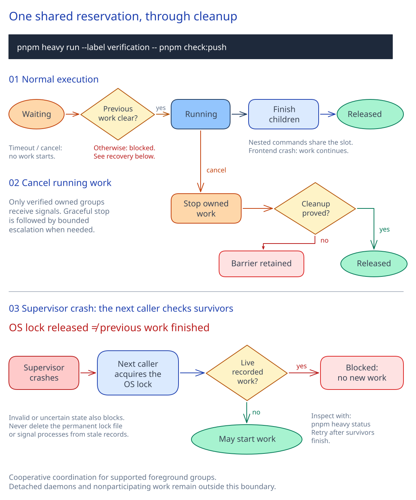

# Sharing the heavy-job slot

Several sessions can read, plan and edit concurrently. Their worktrees still share CPU, memory, disk and GPU capacity. Supported heavy commands reserve one cooperative per-user slot, so independent participating jobs wait instead of starting together. A job can still use many internal workers: this is a concurrency limit, not a resource budget.

## Reservation lifecycle



[Full-size diagram](../diagrams/heavy-job-lifecycle.svg) · [Editable Excalidraw source](../diagrams/heavy-job-lifecycle.excalidraw). The diagram shows lifecycle stages, not additional ownership metadata statuses.

- **Normal execution:** acquire the OS lock and check previous ownership before starting work. Keep the reservation through nested commands and supported foreground children, then release it. A frontend crash leaves supervised work running.
- **Cancellation:** stopping a waiter starts no work and leaves the owner alone. Cancelling running work stops only verified owned groups; unproved cleanup retains an ownership barrier.
- **Supervisor crash:** the next caller may acquire the OS lock while earlier work still survives. Inspect the recorded ownership before starting anything. Recorded survivors, invalid state or uncertain cleanup block new work. Recovery returns an error; retry after the survivors finish, without deleting the permanent lock file or signalling stale records.

## Commands and participation

```sh
pnpm heavy run --label verification --timeout 300 -- pnpm check:push
pnpm heavy status
```

`run` preserves the caller's working directory, standard input/output/error, argument boundaries and command result. It performs no shell evaluation and never retries an executed command. The default wait is 300 seconds; `--timeout 0` attempts acquisition once. A timeout returns 75 without starting work. A command returning 75 runs once and keeps that result. Labels should name a purpose, such as unit-tests, without credentials or command arguments.

These entrypoints reserve automatically: `check:push`, `test`, `build`, `check:adoption`, `test:browser`, `test:devices`, `browser:doctor` and `browser:cli`. Regression-proof test execution reserves through `runOnBase`. The gate holds one reservation across its checks; adoption holds it across its independent project fixtures. Nested participating commands verify process ownership and reuse that reservation, including across pnpm-created process groups. Use the supported entrypoints: invoking the underlying tools directly does not acquire a slot.

Browser entrypoints retain their cache preloads. Acquisition order is **heavy slot, then GPU lock**. The GPU lock remains responsible for verified profiles, renderer evidence and browser/display cleanup. Do not acquire a heavy reservation from inside an independently owned GPU reservation.

`status` reads advisory ownership and surviving-group information without creating state or acquiring a slot. It is not a full process inventory, resource-utilization report or proof that the machine is idle.

## Platforms and prerequisites

- **WSL2:** Linux Node/pnpm, util-linux `flock`, and readable Linux process/boot information under `/proc`.
- **macOS:** `perl` with its core `Fcntl` and `Time::HiRes` modules, plus OS `ps` and `sysctl`. The Perl launcher uses the OS advisory file lock and keeps its descriptor across execution of the Node supervisor. No npm package or persistent service is installed.
- **Linux:** The same prerequisites as WSL2. BusyBox's `flock` is not a substitute for the util-linux flags this runner uses.

Missing prerequisites fail before the workload starts; installation is an explicit machine-setup action. On other operating systems, including native Windows browser acceptance, the command executes normally without coordination. CI bypass is explicit: only `CI=true` or `CI=1` bypasses. Unset, empty, `false`, `0`, and other values retain local coordination on supported systems. This bypass does not change the separate development-platform guard.

## State and protocol

All cooperating repositories and worktrees must use the same absolute state directory and protocol. The default is `~/.local/state/agent-heavy-job/`; `HEAVY_JOB_STATE_DIR` overrides it for deliberate shared configuration or isolated tests. Keep it on a local filesystem with reliable advisory locking and within one OS/PID namespace. Changing the directory creates a different reservation, not extra machine capacity.

The directory is private to the user. Its permanent `lock` file keeps the same inode across runs and recovery. Never delete, truncate or replace it to unlock a job. `owner.json` is atomically replaced and contains protocol version 1, a run identity, purpose label, working directory, boot identity, timestamps, supervisor/process-group identities and eventual result. It excludes command arguments and environment variables. Unreadable, invalid, foreign-owned or unsafe state blocks execution rather than being guessed away. State written by another implementation or protocol is not silently migrated: cooperating repositories must adopt the same protocol together. Preserve existing records and do not choose a second directory merely to bypass an active reservation.

A private, short control socket lives under a deterministic user/state-specific directory in `/tmp`, avoiding macOS socket-path limits with long home/state paths. It is transient; the permanent lock is always in the state directory. A supervisor removes stale control sockets only after acquiring the OS lock and rejecting any surviving recorded work.

An inherited `HEAVY_JOB_RUN` identifies a candidate reservation; it is not proof of ownership. The runner checks the live supervisor identity, boot and actual process ancestry. Each participating group registers before starting its command. Its Node group leader stays alive until the initial command and supported foreground group children finish. This covers children that outlive their immediate command, and keeps the reservation after a frontend exits.

## Cancellation and recovery

Cancel a waiting command normally; it stops only that waiter's own launcher. It never signals the slot owner. Cancelling a running reservation sends graceful termination to verified owned groups. Groups escalate after two seconds; the supervisor has a bounded fallback. Cancellation returns 143. Normal command exits and signals keep their corresponding result.

A frontend crash leaves its supervisor and reservation running. If the supervisor crashes and the kernel releases the lock, the next runner checks the recorded boot and groups before starting anything. Live recorded work blocks recovery, including ambiguous reused group identities. Zombies do not count as live work; a previous boot is distinguished from the current one. Recovery never signals stale records. If current ownership or cleanup cannot be proved, leave the barrier intact and involve the owner rather than killing processes by name or guessed PID.

For inspection, use `pnpm heavy status`, then compare the private record with the actual boot, process start identity and process group. When the recorded foreground work finishes, retry the original command: recovery reuses the permanent lock inode. If metadata is invalid, preserve it and have the owner reconcile its provenance and work while holding the same OS lock; the runner provides no force-unlock shortcut. Do not switch state directories, delete the lock or clear records to bypass surviving work.

## Supported boundary and verification

Normal foreground processes whose children inherit their process group are covered. Participating nested commands may establish new groups after registration. Arbitrary daemons, double-forking processes and detached groups that bypass the runner are outside the tracked boundary. Process-table checks and cooperative ownership are not a security sandbox. Other users, separate WSL distributions, native Windows activity, containers with separate PID namespaces and nonparticipating commands are not automatically coordinated. Continue checking host load, and leave other sessions' processes, containers and ports alone.

There is no FIFO guarantee, persistent queue, automatic retry, priority, CPU/RAM allocation or permission to increase simultaneous heavy jobs. Waiting does not survive a reboot.

Bounded process tests use private temporary state and owned fixtures, never the live shared slot or another session's processes. They exercise argument/result preservation, real pnpm gate/test/build nesting, cancellation and escalation, frontend/command/supervisor SIGKILL, foreground survivors, invalid state, reboot and identity-reuse cases. macOS parser fixtures and a real Perl-driver check complement platform-native runs; they do not establish physical macOS acceptance. Record the actual tested platforms and commit in the PR. The existing browser cache/API/renderer protections and every coverage floor remain in force.

[ADR 0005](../adr/0005-coordinate-heavy-jobs-with-os-locks.md) records the mechanism and tradeoffs.
