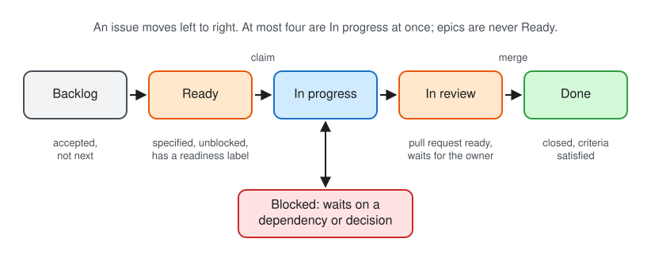

# Issue tracker: GitHub

Issues and specifications for this repository live as GitHub issues. Use the `gh` CLI; it infers the repository inside a clone.

- **Create**: `pnpm issue create` (below); plain `gh issue create` leaves the parent and the Project unset
- **Read**: `gh issue view <number> --comments`
- **Comment**: `gh issue comment <number> --body "..."`
- **Label**: `gh issue edit <number> --add-label "..."` or `--remove-label "..."`
- **Close**: `gh issue close <number> --comment "..."`

The Project, parent and blocker operations have their own command, so nobody looks up field identifiers:

| Command                                                                                                                          | Does                                                                                                                                                                                                                                   |
| -------------------------------------------------------------------------------------------------------------------------------- | -------------------------------------------------------------------------------------------------------------------------------------------------------------------------------------------------------------------------------------- |
| `pnpm issue create --title <t> --label <l>... [--body-file <f> \| --body <text>] [--parent <n>] [--status <s>] [--priority <p>]` | Creates an issue with labels, parent and Project fields in one step and reads it back; refuses incomplete metadata, or a task without "Done when" criteria, before creating anything                                                   |
| `pnpm issue show <number>`                                                                                                       | Prints labels, parent chain, Status, Priority and blockers, and lists what the metadata rules below find missing                                                                                                                       |
| `pnpm issue status <number> <status> [priority]`                                                                                 | Adds the issue to the Project if needed, sets Status and optionally Priority, and reads back                                                                                                                                           |
| `pnpm issue parent <number> <parent>`                                                                                            | Sets the native parent                                                                                                                                                                                                                 |
| `pnpm issue blocked-by <number> <blocker>`                                                                                       | Adds a native blocker; the blocker may be `owner/repo#number`                                                                                                                                                                          |
| `pnpm issue ready`                                                                                                               | Lists the Ready issues, highest Priority first, with their readiness label                                                                                                                                                             |
| `pnpm issue claim <number> [--check]`                                                                                            | Assigns you and sets In progress, or says why the issue cannot be started, incomplete metadata included; `--check` only reports; warns when another issue In progress or In review touches the same files                              |
| `pnpm issue wip`                                                                                                                 | Lists the issues In progress against the limit                                                                                                                                                                                         |
| `pnpm issue standup`                                                                                                             | One overview without a model: issues In progress with their worktree on this machine, In review with each open pull request's build and how far it is behind `main`, blocked issues and their blockers, and the next five Ready issues |

These need `gh` with the `project` scope. Without it, follow ["When you cannot do a step"](../../AGENTS.md#when-you-cannot-do-a-step).

## Issue metadata

Every new issue needs the following, whether it is created through the [template](../../.github/ISSUE_TEMPLATE/task.md), the CLI or the API. CLI and API creation bypass the template, so pass labels explicitly.

1. **Labels.** At least one work-type label (`bug`, `enhancement`, `documentation`, `investigation`, `verification` or `epic`) and at least one `area:*` label. Add `decision-needed` when the owner must decide before the work can finish. `needs-triage` is a temporary fallback. See [triage labels](triage-labels.md).
2. **Parent.** A native parent whose ancestry reaches an issue labelled `epic`. A root epic needs no parent; it carries the `epic` label and an `Epic:` title prefix. A textual `Part of #...` line alone is insufficient.
3. **Project.** Membership in the repository's Project with a Status. New issues start in **Backlog** unless they meet the Ready rule below.
4. **Acceptance criteria.** A task issue has a "Done when" section with at least one checklist item that says how completion is checked. The pull request is checked against these items, and without them "done" is a matter of opinion. `pnpm issue create` refuses a task without them; an epic is exempt, since its children carry the criteria.
5. **Readback.** Run `pnpm issue show <number>` and correct what it reports before calling the issue created or starting work on it. It exits with an error while the metadata is incomplete.

**Touches (optional).** A task issue may list the files or folders it expects to change in a "Touches" section, one glob pattern per list item, for example `scripts/browser-gpu*.ts`. Up to four issues run at once in separate worktrees; two that change the same files conflict at the second merge. `pnpm issue claim` (and so `pnpm task start`) warns, without refusing, when an issue In progress or In review lists an overlapping pattern, and names it; the owner then decides whether the work may run side by side or one waits. `pnpm issue show` prints the section. Patterns overlap when they can match a common path; the check errs towards a warning.

An epic holds the requirements for one outcome and uses the [Epic template](../../.github/ISSUE_TEMPLATE/epic.md); pass its sections as the body when creating one from the command line. The first issue of a repository is a root epic; create it before any task.

A pull request names its issue. Use `Closes #<number>` when the pull request completes that issue's "Done when" criteria; use `Part of #<number>` for a slice of a larger issue. When an issue is delivered in slices, create one sub-issue per slice before starting it.

Issues and PRs own coordination and review. Keep substantive research, evolving designs and accepted rationale in the tracked records defined by [knowledge ownership](decision-workflow.md#knowledge-ownership), and link them from the issue. An investigation's acceptance criteria can require useful findings and open questions without selecting a solution or authorizing implementation.

## Picking and claiming work

An issue is claimed when it is assigned to someone and its Status is In progress. `pnpm issue claim <number>` does both and refuses when the issue may not be started.

- **No issue was named.** Take the Ready issue with the highest Priority whose readiness label fits you: an agent takes `ready-for-agent`, a person either.
- **You were told to work on a specific issue.** That instruction is the assignment, whatever the issue's Status, with these exceptions. Report the exception to the owner and stop:
  - it carries `decision-needed`, `needs-triage` or `needs-info`: the specification is not settled;
  - it has an open native blocker;
  - it is an epic: work on one of its children, or propose children if it has none;
  - it is assigned to someone else or already In progress under another session;
  - four issues are already In progress.
- **The issue is `ready-for-human` and you are an agent.** Prepare what you can, such as research or a draft, only if the owner asked you to; the label means a person does the work.
- **No issue exists for the work.** If the owner asked for the work, create the issue with `pnpm issue create`, then claim it. An issue you propose yourself goes to Backlog without a readiness label, and you do not start it: the owner decides what is built and sets Ready. A pull request without an issue is not accepted, except Dependabot's.
- **You stop without finishing.** Leave a handoff; keep the claim if you will resume, otherwise remove your assignment and set the Status back to Ready.

## Images

With gh 2.99 or later, attach images to issues and pull requests with `--attach`, repeatable, on `gh issue create|edit|comment` and `gh pr create|edit|comment`:

```sh
gh issue comment 123 --body-file comment.md --attach './screenshot.png#Alt text'
```

A Markdown reference in the body, ``, is replaced with the uploaded image.

## Project

The Project linked to this repository is its live planning and execution view. `pnpm setup:github` creates it and prints its URL; it is also listed on the repository's Projects tab.

- GitHub Issues are the source of truth for task scope, acceptance criteria, discussion and closure. Link maintained design specifications and lasting findings in tracked records.
- The Project's **Status** and **Priority** fields are the source of truth for execution state and order.
- Native issue blockers define required order. Do not infer dependencies from priority.
- Parent issues describe outcomes and report progress. Their child issues are the executable work.
- Area, type and readiness stay in repository labels; do not duplicate them as Project fields.



Statuses:

- **Backlog**: accepted work that is not next or not ready to start.
- **Ready**: specified, unblocked work that can be claimed. It carries `ready-for-agent` or `ready-for-human` and has no open native blocker.
- **In progress**: actively being implemented or validated. At most four issues are In progress at once, not counting epics; finish or hand back one before starting a fifth.
- **In review**: the pull request is ready and awaits the owner's merge authorization.
- **Blocked**: started work paused by an unresolved dependency or decision. Add the native blocker, or name the decision or resource and who provides it in the issue.
- **Done**: the issue is closed and its acceptance criteria are satisfied.

A readiness label says who can do the work; Status says when. An issue may carry a readiness label in Backlog or Blocked. Epics carry no readiness label and are never Ready: an epic is **In progress** while a child is In progress or In review, and **Backlog** otherwise.

**Priority** orders Ready and started work: **P0** is done first, **P1** next, **P2** when nothing above it is available. An issue gets a priority when it leaves Backlog; the metadata check reports one without, and `pnpm task start` refuses it. Take the highest-priority Ready issue that matches the session; the owner changes priorities.

When work starts, claim the issue, which moves it to **In progress**. Move it to **In review** when its pull request is ready, and to **Blocked** if progress stops for one of the reasons above. When the issue closes, set **Done** and read the Status back; closing an issue does not move it unless the Project's built-in workflow for closed items is switched on in the GitHub UI.

Record a dependency on an issue in another repository of the same owner as a native blocker, and add the blocking issue to this Project when work here is planned around it.

Before closing an issue or epic, apply the [completion criteria](task-lifecycle.md#validate-and-complete). Use the [handoff procedure](task-lifecycle.md#handoff-with-unfinished-work) when transferring or stopping unfinished work.

Use `pnpm issue` for Project reads and writes; for what it does not cover, use `gh project` and `gh api graphql`. When changing the options of a single-select field through the API, pass every existing option with its `id`; options sent without one are recreated and their item values are lost. After bulk changes, verify item counts, field values and view filters. View grouping, sorting and built-in workflows are set in the GitHub UI; record that work in a `ready-for-human` issue rather than claiming it was automated.
