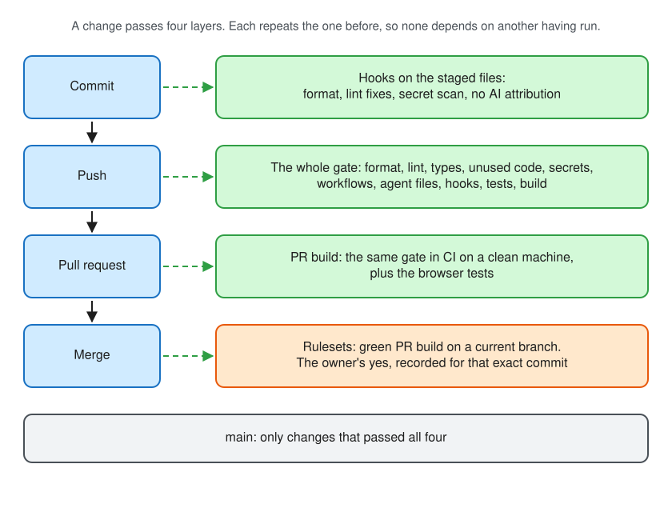

# Local verification

Checks run at three points. Each later point repeats the code checks of the earlier ones, so those do not depend on a hook having run. The commit-message check is the exception: it runs at commit, and again over a pull request's commits in `pnpm task ready`.

| Point        | Runs                                                                                                  | Defined in                                                                            |
| ------------ | ----------------------------------------------------------------------------------------------------- | ------------------------------------------------------------------------------------- |
| Commit       | Prettier and Secretlint on staged files, Oxlint with fixes on staged source; the commit-message check | `lint-staged` in `package.json`, `.githooks/pre-commit`, `.githooks/commit-msg`       |
| Push         | A clean working tree at the pushed commit, then the whole gate: `pnpm check:push`                     | `.githooks/pre-push`, `scripts/git/pre-push.ts`, `scripts/checks/run-local-checks.ts` |
| Pull request | The same code/build gate; local GPU browser evidence is reported on the PR                            | `.github/workflows/pr-build.yml`                                                      |

The gate runs these in order and reports every failure, not only the first: `format:check`, `lint`, `typecheck`, `check:unused`, `check:secrets`, `check:workflows`, `check:agents`, `check:links`, `check:dependencies`, `check:hooks`, `test`, `build` and `check:bundle`.

An explicit [release](../operations/releases.md) repeats the gate at the tagged candidate and runs the complete required Chromium smoke suite at the root and a nested URL base before publication. It packages that tested build. This release check is unconditional; PR browser acceptance runs locally on the GPU and is reported on the PR.

`check:unused` runs knip twice: as on a developer's machine and with `CI=true`, as the `PR build` runs it. knip loads tool configurations such as `playwright.config.ts` to find what they use, and a configuration may differ in CI, for example a reporter registered only for local runs. A file used only one way is then reported before the push instead of in the `PR build`.

`lint` runs Oxlint with its type-aware rules, which need the `oxlint-tsgolint` package: an unawaited promise or a value of the wrong type in a template string fails it. The commit hook lints staged files without types, for speed. No rule is switched off except `react/react-in-jsx-scope`, which belongs to the JSX transform before React 17; React 19 and Vite use the automatic one. The React plugin adds the rules of hooks and missing effect dependencies; the `jsx-a11y` plugin adds accessibility rules for JSX. A type assertion is refused, so JSON that a script reads, from `gh` or from a file, is checked with a shape from `scripts/shared/json-shape.ts`; a missing or wrongly typed field then fails where it is read, with its path.

`test` measures coverage and fails below the global floor or either independent `src/**` and `scripts/**` floor: 95% of statements, functions and lines and 90% of branches. `vite.config.ts` uses the floors from `scripts/checks/coverage-thresholds.ts`. Vitest applies the global floor to all measured files, including the two groups; one group cannot compensate for the other. `scripts/checks/coverage-groups.test.ts` runs bounded real Vitest fixtures: an undercovered application and undercovered tooling each pass global-only enforcement and fail their own group, while fully covered controls pass. Fixtures run one dedicated test, never the repository suite, so they cannot recurse. The measured files are `src/` and `scripts/` without tests, the browser entry point and the commands that run `git`, `gh` or the network; the rules those commands apply live in separate modules, which are measured. A new command file is added to that exclusion list; a new rule module is not. Components that render only in a browser, such as a WebGL map, can be excluded the same way with the reason in `vite.config.ts`, when the browser tests cover them and their logic lives in plain modules that are measured. The floor is a lower bound, not a goal. Review thresholds deliberately when the product or testing strategy changes; incidental coverage gains do not require raising them. This avoids threshold edits after each gain, while allowing later changes to consume coverage above the floor. Keep the current floors unless the owner decides to change them; lowering one remains a guardrail change requiring the owner's explicit decision. HTML and machine-readable `coverage-summary.json` reports are written to `coverage/`. Keep future product logic measured in `src/`; growing tooling must not dilute its independent floor. Coverage measures execution, not correctness, and browser-only lifecycle acceptance remains separate.

Application and tooling floors are independent so well-covered tooling cannot hide under-tested product code. Inspect the current JSON report for each group's counts and exclusions; component event wiring can be unit-tested, while real DOM typing remains a browser responsibility.

`lint` also runs rules that guard against unsafe code: no `eval`, `new Function`, `javascript:` URLs or `__proto__`, and no use of `any` values in calls, assignments, returns or member access (`.oxlintrc.json`). Oxlint finds patterns, not data flows. In a public repository, `.github/workflows/codeql.yml` adds CodeQL's security queries for the TypeScript and the workflows on every pull request, on `main` and weekly, with findings under the Security tab; GitHub offers it free only there, so a private repository skips it.

`check:dependencies` compares `pnpm-lock.yaml` with the merge base on `origin/main` and lists every package version the branch adds, with its licence and whether it ships at runtime; in the PR build the list goes into the job summary. It fails when a runtime dependency's licence is not in `.github/allowed-licenses.json`, unless the package is named in `.github/allowed-packages.json` with the owner's reason, as for an SDK under its vendor's own terms. Development tools may carry other licences, since they do not ship. It needs `origin/main`; fetch it when the check says it is missing.

`check:bundle` measures the gzip size of `dist/` by kind (JavaScript, CSS, HTML) after `build` and fails above the limits in `bundle-budget.json`. The limits are a starting point for a small application: lower them once the application has a size, and raise one only with a reason in the pull request. The sum counts every file, also chunks loaded only on demand: with an SDK that splits itself into many such chunks, such as a map SDK, the JavaScript limit tracks the size of the whole SDK rather than what a user downloads first.

`check:agents` covers the files agents read: the pointer files contain only their pointer, no other tool's instruction file exists unregistered, `AGENTS.md` stays within its size limit, every guardrail names a mechanism that exists, and `.claude/settings.json` only denies. The Gemini pointer, `.gemini/settings.json`, uses the `context.fileName` key from Gemini CLI's configuration reference. `check:links` resolves every link between Markdown files, heading anchors included: the rules are found through those links.

The pre-push hook first refuses a push whose checks would not describe it: a working tree with uncommitted or untracked files, or a pushed branch, or tag of a commit no remote branch has yet, that points at another commit than the checked-out one. Branches are judged by where they land, so `git push origin <commit>:topic` is refused from a checkout of another commit. "The gate passed" is then a statement about the pushed commit. `pnpm check:push` by hand has no such condition and tests the working tree as it is.

The pre-push hook validates the outgoing refs and source in its actual hook context, then copies the environment and removes the names reported by `git rev-parse --local-env-vars` before launching child checks. Those checks run from the validated worktree; their temporary repositories discover their own Git state. The caller environment, push validation, post-check source recheck and child failure propagation are unchanged. Keep fixture-local isolation for standalone invocations too.

The hooks are tracked files under `.githooks`. `pnpm install --frozen-lockfile` points Git at them once for the whole repository, so every worktree uses them; each worktree still needs its own `pnpm install --frozen-lockfile` for the tools the hooks call. `check:hooks` fails when the hooks are not active, or when a hook Git would run from this worktree is missing or not executable; it helps when the gate is run by hand, since an inactive hook cannot report itself.

**Hooks in task worktrees.** Task worktrees run the same Git hooks as the main checkout: Git resolves the relative `core.hooksPath` against each worktree, so the hooks tracked in its own checkout run. Agent tools have been reported to skip their own hooks (for example hooks in a tool's settings file) inside worktrees; this repository relies on Git hooks only, which are not affected. `scripts/git/git-hooks.test.ts` builds a repository with a worktree and proves that a commit there runs the tracked hook. A test that runs `git` must leave out the `GIT_*` environment variables: inside a hook in a worktree, Git sets `GIT_DIR` (and in the commit hooks `GIT_INDEX_FILE`), and a test the pre-push hook runs would otherwise commit into this repository instead of its scratch one. To repeat the check in a real task worktree:

```sh
pnpm check:hooks                                    # PASS · Git hooks active in <worktree>/.githooks
git commit --allow-empty -m "x" -m "Co-Authored-By: A <noreply@anthropic.com>"   # refused by commit-msg
touch scratch.txt && git push --dry-run origin HEAD:refs/heads/hook-check; rm scratch.txt  # refused by pre-push
```



## Shared workload reservation

Supported workloads acquire one per-user reservation across participating repositories and worktrees. The full gate retains it across its checks, and adoption/regression-proof workflows reuse it through verified nested ownership. Browser commands acquire the shared slot before their separate GPU lock and retain cache initialization. See [workload guidance](workload-coordination.md) for commands, WSL2/macOS/Linux prerequisites, state, CI behavior, cancellation, recovery and process boundaries. Bounded fixtures use isolated state; they never contend for the live shared slot.

## Development platforms

Run the complete gate and adoption verification on WSL2, macOS or Linux; see [setup and support boundaries](../setup.md#windows-development-with-wsl2). `scripts/shared/development-platform.ts` guards `pnpm task start`, `pnpm check:push` and `pnpm check:adoption` before task claims, checks or fixture creation. There is no CI bypass: CI must use a supported platform too. WSL2 is a setup prerequisite; Node's `linux` platform value alone cannot distinguish WSL1.

Native Windows installation, standalone diagnostics and [browser/GPU acceptance](browser-device-coverage.md#install-and-launch-on-windows-and-wsl-separately) remain available. They do not establish full native Windows development support. Unit tests simulate platform rejection and prove protected entrypoints start no work; these tests do not establish real macOS, WSL or Windows acceptance.

## Rules

- Run `pnpm check:push` yourself before asking for a merge when you changed the gate, a hook or a workflow; the hook only proves the state at push time.
- Fix a failing check. Do not skip a hook with `--no-verify`, weaken an assertion or remove a check to get a push through; a changed tolerance or guardrail needs the owner's decision, recorded in the pull request.
- A lint finding that is wrong for one place is suppressed there, never for the whole repository: `// oxlint-disable-next-line <rule>` with a comment saying why, after the owner has agreed in the pull request. Prefer changing the code; an exception is the last resort.
- `check:workflows` downloads pinned `actionlint` and `zizmor` binaries into `.artifacts/` on first use and verifies their checksums. zizmor looks for security mistakes such as template injection, credentials left by checkout, broad permissions and caches that reach published builds; it runs offline. A finding that is safe on purpose is suppressed where it occurs with `# zizmor: ignore[<audit>]` and a comment saying why, or for the whole repository in `.github/zizmor.yml`. It supports macOS and Linux on x64 and arm64 and needs `tar` and, on first use, network access. On Windows use WSL2. It also lints the shell in workflow steps when `shellcheck` is installed, as it is on the CI machine; install `shellcheck` locally to get the same findings before pushing a workflow change.
- Record a check done by hand once, with who did it and when, the commit, environment or URL, steps, and expected and actual result. Put it in the PR or link its reviewable result from there; reviewers must be able to access it. This avoids stale duplicate reports. An ignored local path alone gives remote reviewers no access. A required check that failed or was not done keeps the PR open.
- If a hook itself is broken, so that it fails for a reason unrelated to the change: run `pnpm check:push` by hand, push once with `--no-verify`, state the reason in the pull request and file a `bug` issue for the hook. This never applies to a check that fails on the change.
- Editing a pull request's title or body does not rerun CI; a new commit does. Report local results and CI results separately, each with its commit.

Keep retained logs, reports and verification notes under the primary checkout's ignored `.local/`, following the [artifact naming guidance](working-style.md#local-artifacts). Browser run records and default GPU reports resolve the primary task artifact folder. Legacy records remain readable. Tool-owned `coverage/`, `test-results/` and reports keep their existing paths; copy wanted evidence before removing a task worktree.

Bundled Playwright browsers are shared by worktrees under the Git common directory,
in `playwright-browsers/<platform>-<arch>`; explicit `PLAYWRIGHT_BROWSERS_PATH` overrides win.
Install through `pnpm test:browser:install` or `pnpm browser:cli install <engines>`,
not a raw Playwright install.
`pnpm browser:check` reports the inspected cache and missing build directories; it
is on demand, so the ordinary gate does not require browser downloads.
`scripts/browser/playwright-browsers-contract.test.ts` guards supported command/workflow
entrypoints. See [browser setup](browser-testing.md#on-your-machine) for overrides
and system-library requirements.

PR browser acceptance runs locally on the GPU, with results reported on the PR; explicit release verification runs separately; see [browser testing](browser-testing.md).

## Typechecking

Four TypeScript projects separate the environments: `tsconfig.app.json` covers application source with browser types and no Node.js types; `tsconfig.test.json` covers application unit tests with browser and Node.js types; `tsconfig.node.json` covers tooling (including its unit tests) and config files with Node.js types and no browser types; and `tsconfig.e2e.json` covers `e2e/`. `pnpm typecheck` runs all four. A new top-level source directory is not checked until it is added to the `include` of one of them, or given its own project in `tsconfig.json` and in the `typecheck` script, and to `project` in `knip.json`.

## Adding a check

1. Add the script to `package.json` and its name to the list in `scripts/checks/run-local-checks.ts`. The PR build picks it up from there.
2. Add or update the row in the `AGENTS.md` guardrail table, naming the script. `pnpm check:agents` rejects a row whose script or file does not exist.
3. Prove that the check can fail: a test, or a control inside the check, gives it a deliberate violation and expects a rejection. `scripts/checks/workflow-contract.test.ts` and `scripts/checks/check-secrets.test.ts` are examples. A check that was never seen to fail proves nothing.
4. If the check needs its own CI job, add the job to `pr-build.yml` and its job name to the required status checks in `.github/rulesets/main-integrity.json`. Every PR-build job must be directly required; `scripts/checks/workflow-contract.test.ts` checks this and pins the expected status list, which must be updated deliberately. Give the job a timeout, disable checkout credentials and set artifact retention where applicable. Apply the matching hosted-ruleset change through the procedure in [GitHub hosted settings](../operations/github-hosted-settings.md#the-rulesets), recording its readback. Adding a step to the existing job needs no new required status.

For adaptations with another language/native toolchain or measured expensive acceptance, consult [mixed-language adoption](adoption-patterns.md#mixed-language-adoption) and [expensive verification](adoption-patterns.md#expensive-verification). These optional design procedures do not change this repository's full gate or permit reusing evidence outside its current rules.

## Fresh-project adoption

Run `pnpm check:adoption` on a clean, committed revision after changes to initialization/setup, personalization instructions, entry points, dependency/configuration discovery or the adoption check itself. It is an on-demand acceptance command outside `check:push` and the unit inventory: adding it to the ordinary gate would make each fixture launch another fixture. A runtime guard also rejects recursive invocations before any Git/install work.

The command archives tracked files at HEAD and creates independent temporary repositories with fresh histories and separate local bare origins. Each installs from the committed lockfile and runs the source project's gate, then replaces its README and application with a minimal fixture to test the inherited tooling. React sources exercise both React and framework-free fixtures; sources that already removed React exercise the framework-free fixture. Missing optional demo files are allowed. Each fixture stages its new/deleted files, runs frozen installation and the full gate/build, and requires an intentionally missing HTML entry point to fail the build. This verifies tooling reuse after personalization; the fixture's small greeting is not acceptance of the source project's UI. Keep running the project's normal unit and browser tests for that evidence.

Fixtures never call hosted setup. The setup unit fixtures use a controlled CLI to verify read-only plans, argument rejection and apply idempotency without real hosted resources. Help requires no configuration or authentication; dry-run still needs read permissions. See [setup modes](../operations/github-hosted-settings.md#inspect-before-applying). The opt-in `pnpm check:personalization` reads repository identity and checks local ownership/package/HTML metadata; `pnpm setup:github` applies the same preflight before hosted mutations. It stays outside the ordinary gate so the documented initial gate works on an unpersonalized copy. See [setup](../setup.md#start-a-new-repository). The preflight checks local syntax and placeholders, not whether GitHub grants a named user/team access.

On a capacity-constrained host, an explicit `VITEST_MAX_WORKERS=2` limits test worker fan-out without changing selection, assertions, timeouts or coverage floors. Adoption preserves this resource setting across fixture gates while removing other inherited Vitest runner state and Git overrides.

This costs several full gates and public-registry/tool downloads on a fresh cache; run it alone on a quiet machine. It provisions no remote repository or hosted setting and never invokes hosted setup. Local results establish adoption through checks/build only. They do not prove GitHub Pages/Project/ruleset provisioning, real browser/GPU rendering, or a library adaptation without HTML. Record separate hosted/browser evidence or these limits in the PR.

## Regression proof

For a pull request closing a `bug` issue, `pnpm task ready` runs new or changed unit tests as they are on the head against the merge base in a temporary worktree. At least one test must demonstrate a behavioral failure without the fix, through code present before the fix. A test that fails to load or only imports a new API does not count. Browser tests are too slow to run twice here: name their control run in the PR on a line starting "Regression control", followed on that line by what failed on old code or on a deliberate violation.

The base run uses Vite's installed TypeScript/TSX parser to guard static value imports. Missing named/default exports and directly read namespace members are availability failures, not apparent behavioral TypeErrors; a present but broken value or an existing function throwing a TypeError still counts. Type-only imports and Vitest's framework import are untouched. Parser errors stop proof; production code and test assertions are unchanged. Namespace checks preserve identity, method receivers and computed-key evaluation.

Indirect namespace aliases, destructuring, dynamic imports, mocks and helpers still need manual review against the pre-existing-behavior rule. The check does not prove test intent. `scripts/workflow/regression-proof.ts` owns the transformation; its real Vitest fixtures in `scripts/workflow/regression-proof.test.ts` exercise missing exports, valid behavioral TypeErrors, type-only imports and temporary-worktree cleanup.

Regression-proof fixtures expose only the Vitest runner and its package to test sources. Their TSX case uses a local JSX factory, so removing the replaceable React application does not turn a behavioral regression into a missing-framework load failure. The TSX control fails on incorrect arithmetic and passes on the corrected implementation without React.
