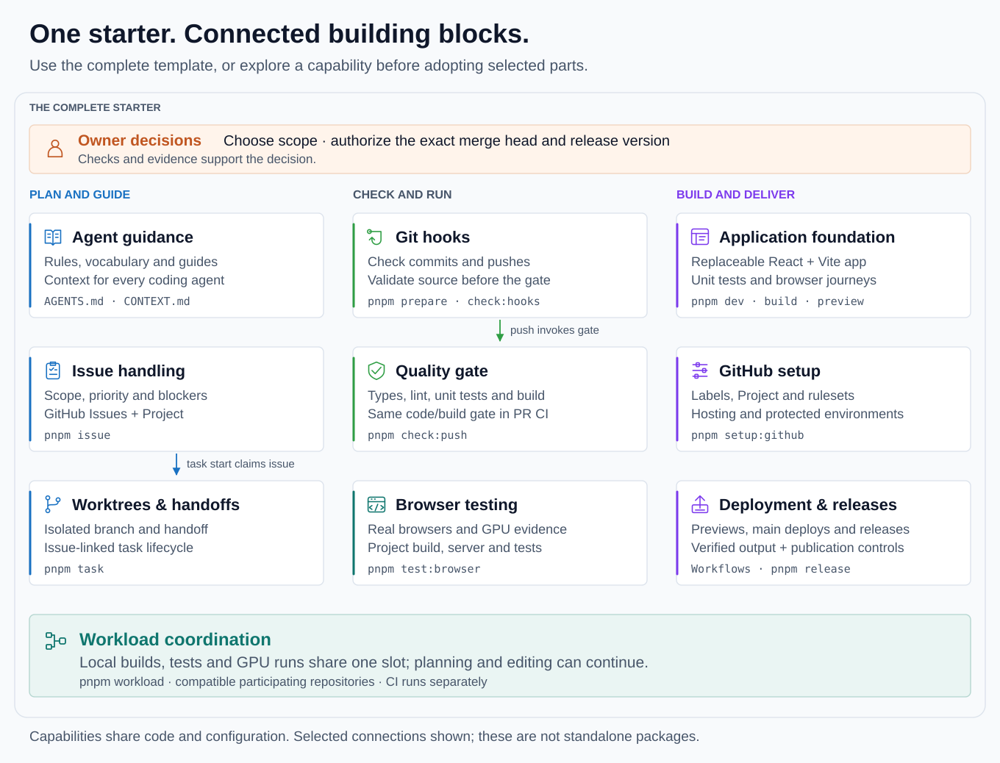

# Building blocks

The complete starter brings an application, agent workflow, verification and delivery together. Use the [whole template](setup.md) for a new project. For an existing project, use this map to understand a capability before deciding what to adopt.

These are connected capabilities in one private package. They are not separately installable packages, and a folder alone is not an adoption unit: commands also depend on shared helpers, configuration, hooks and workflows. The [scripts map](../scripts/README.md) identifies the implementation owners; this page explains what each block offers and where it connects.

## The complete picture

<picture>
  <source media="(max-width: 900px)" srcset="diagrams/building-blocks-narrow.svg">
  
</picture>

The picture groups responsibilities, rather than showing isolated packages or every dependency. Its connections are:

- **Plan and guide:** shared instructions define how agents work; issue handling supplies scope and priority; task commands claim an issue, prepare its worktree and retain handoffs.
- **Check and run:** Git hooks call verification, the PR build repeats the code/build gate, and browser testing supplies separate evidence to task readiness.
- **Build and deliver:** the application supplies the build and browser journeys; GitHub setup provisions hosted controls; deployment and release workflows consume verified output under those controls.
- **Coordinate local work:** participating builds, tests and GPU runs share a workload slot. Planning and editing can continue while they wait; CI runs separately.
- **Owner decisions:** the owner chooses scope and authorizes the exact merge head and release version. Checks support those decisions.

For the sequence through these blocks, see the [agent workflow](../README.md#how-the-agent-workflow-fits-together) and [GitHub workflow](../README.md#through-github-issues-projects-and-pull-requests) illustrations. The sections below link the more detailed diagrams for verification, devices and workload recovery.

## Find a block

| Need                                | Block                                               | Main connection                                      |
| ----------------------------------- | --------------------------------------------------- | ---------------------------------------------------- |
| Give agents consistent context      | [Agent guidance](#agent-guidance)                   | Instructions, vocabulary and task-specific guides    |
| Define and prioritize work          | [Issue handling](#issue-handling)                   | GitHub Issues and the Project feed task commands     |
| Isolate changes and resume work     | [Worktrees and handoffs](#worktrees-and-handoffs)   | Local Git state is orchestrated with issues and PRs  |
| Check commits and pushes            | [Git hooks](#git-hooks)                             | Hooks invoke checks at Git boundaries                |
| Verify a change consistently        | [Quality gate](#quality-gate)                       | Local push and PR CI run the same code/build gate    |
| Exercise a real browser and GPU     | [Browser testing](#browser-testing)                 | Project build, Playwright configuration and evidence |
| Build the product                   | [Application foundation](#application-foundation)   | Replaceable app, tests and production output         |
| Configure hosted controls           | [GitHub setup](#github-setup)                       | Labels, Project, rulesets and environments           |
| Publish previews, deploy or release | [Deployment and releases](#deployment-and-releases) | Verified builds and hosted publication controls      |
| Avoid competing local workloads     | [Workload coordination](#workload-coordination)     | Shared reservation around participating commands     |

## Agent guidance

**Purpose and entry points.** [AGENTS.md](../AGENTS.md) is the common instruction source, [CONTEXT.md](../CONTEXT.md) supplies vocabulary, and the [engineering index](README.md) routes contributors to the relevant guide. Agent-specific entry files point to the shared rules. The named skills are described in [AI tools](agents/ai-tools.md#skills).

**Connections and reuse.** Instructions refer to real commands, checks and approval boundaries throughout the repository. In another project, reconcile its existing policy and command names before adopting guidance. Copying the text does not install its enforcement mechanisms or establish that an agent follows it. The [agent workflow illustration](../README.md#how-the-agent-workflow-fits-together) shows instructions and retained knowledge feeding the session.

## Issue handling

**Purpose and entry points.** `pnpm issue` creates, inspects and updates issues, parent/blocker relations and Project fields; `ready` and `standup` expose work to pick up and work in flight. Implementation lives in `scripts/workflow/issue*.ts` and supporting modules.

**Connections and reuse.** It uses `gh`, shared GitHub/JSON helpers and a linked Project with the starter's labels, statuses and Priority options. Claiming work assigns an issue and changes its status; these are remote writes. Task orchestration calls this capability. Selective adoption needs compatible hosted APIs and explicit choices about metadata and publication permissions; the present CLI is not a generic issue-tracker adapter.

See the [issue guide and status diagram](agents/issue-tracker.md), and the [Project board and GitHub workflow](../README.md#through-github-issues-projects-and-pull-requests) for how metadata, tasks and PRs fit together.

## Worktrees and handoffs

**Purpose and entry points.** `pnpm task start`, `resume`, `handoff` and `cleanup` manage task setup, recovery, resumable state and verified cleanup. `ready` and `merge` complete the PR lifecycle. Their implementation is in `scripts/workflow/task*.ts`, with regression proof alongside it. `pnpm local:init` separately prepares the primary checkout's ignored scratch area.

**Connections and reuse.** `start` combines local Git/worktree operations with issue claiming and dependency installation. `ready` examines PR/build state, browser evidence and applicable regression proof; `merge` records authorization and updates hosted state. The commands depend on more than Git: current issue conventions, pnpm, the named PR check and project policy are part of the contract. Local worktree operations are not currently offered as a separately supported, GitHub-free package.

Use the [task lifecycle](agents/task-lifecycle.md) for recovery, handoffs and cleanup, and the [GitHub workflow illustration](../README.md#through-github-issues-projects-and-pull-requests) for the owner decision between readiness and merge.

## Git hooks

**Purpose and entry points.** `pnpm prepare` installs the tracked `.githooks/`; `pnpm check:hooks` verifies activation. Commit hooks check staged content and attribution. Pre-push verifies the outgoing commit and clean source state, runs the full gate and rechecks the source. Implementation lives in `scripts/git/` and the hook files.

**Connections and reuse.** Hooks invoke package commands and depend on each worktree's installed tools. Installation sets Git's hook path, which must be reconciled with an existing hook manager. The attribution rule, staged tooling and clean-push requirement are project policies to assess explicitly. Hooks can be bypassed, so the independent PR gate remains part of enforcement.

See [local verification and the guardrails diagram](agents/local-verification.md) for what each Git boundary checks and what CI repeats.

## Quality gate

**Purpose and entry points.** `pnpm check:push` orchestrates formatting, lint, types, unused code, secrets, workflows, agent files, links, dependency licences, hook activation, unit coverage, build and bundle budget. Individual `check:*` commands expose specific checks. Most implementation is in `scripts/checks/`.

**Connections and reuse.** The push hook and `PR build` call this gate; its configured commands assume the starter's toolchain, paths and application output. Vitest coverage, Vite output and the bundle budget are concrete dependencies. `pnpm check:adoption` separately verifies fresh React and framework-free application fixtures; it does not prove arbitrary selective adoption or hosted setup. Some checks also use Git history, hosted-independent configuration and native tools.

An existing project can assess individual checks, but must trace each script's helpers, configuration and tests before copying it. Changing required checks or thresholds is a project decision. See [verification](agents/local-verification.md) and the optional [adoption patterns](agents/adoption-patterns.md); the [guardrails diagram](diagrams/guardrails.svg) shows the layers rather than a claim that every rule is mechanically enforced.

[Dependency automation](agents/dependency-automation.md) complements the gate with Dependabot updates and a scheduled production audit. Its configuration and hosted workflow are additional adoption inputs; the scheduled audit is not a step in the push gate.

## Browser testing

**Purpose and entry points.** `pnpm test:browser` builds fresh local output and runs the project's Playwright journeys. `browser:doctor` discovers GPU routes; `browser:check` inspects the browser cache; `browser:cli` and `test:devices` support installation, other engines and remote targets. Tests live in `e2e/`, tooling in `scripts/browser/`, and integration in `playwright.config.ts` and package scripts.

**Connections and reuse.** Local execution ties together build/source checks, the configured server, browser-cache initialization, GPU discovery/ownership, Playwright setup and evidence reporting. Task readiness reads that evidence; device reporting can post to a PR when explicitly requested. The current build/server path assumes the starter application, so copying `scripts/browser/` alone does not configure another project's server or journeys. A GPU probe establishes API access, not that the actual application painted correctly.

See [browser testing](agents/browser-testing.md), [GPU discovery](agents/browser-gpu-discovery.md) and the [browser/device matrix illustration](agents/browser-device-coverage.md). The matrix shows available testing paths, not completed platform acceptance. Functional remote testing and local hardware evidence remain distinct.

## Application foundation

**Purpose and entry points.** `pnpm dev`, `build` and `preview` run the replaceable React/TypeScript/Vite application. `src/`, `index.html`, Vite/TypeScript configuration, unit tests and `e2e/` define the product and its checks. The example includes native WebGL2 and WebGPU renderers.

**Connections and reuse.** The app supplies the output consumed by browser testing, the bundle budget and delivery workflows. [Setup](setup.md#replace-the-example) documents replacement and the framework-free route. That route still builds a web application; a Node tool, library or project with several outputs needs its own adaptation and verification. A static review website and a compiled CLI need not share the starter's build layout.

The [example application](../README.md#example-application) and its [capture provenance](diagrams/README.md#actual-ui-capture) show what the starter renders, with the scope of that observation.

## GitHub setup

**Purpose and entry points.** `pnpm setup:github` applies hosted labels, Project configuration, merge settings, rulesets and environments. Its `--help` and `--dry-run` modes explain or inspect setup before applying it. `pnpm check:personalization` checks project identity. Implementation lives in `scripts/setup/`, supported by checked-in `.github/` configuration.

**Connections and reuse.** Issue/task commands depend on hosted conventions; deployment depends on provisioned hosting and environments. These settings are not inherited merely by creating a repository from the template. Applying setup makes remote changes and needs the appropriate rights. A different host or existing repository needs a capability/configuration review: a successful local fixture or read-only plan does not prove hosted application will succeed.

Use [GitHub hosted settings](operations/github-hosted-settings.md) for the supported modes and readbacks. The [GitHub workflow illustration](../README.md#through-github-issues-projects-and-pull-requests) shows how those settings support issue and PR delivery.

## Deployment and releases

**Purpose and entry points.** `.github/workflows/` defines application deployment, optional PR previews and releases. `pnpm setup:previews` configures preview hosting; `pnpm release <version>` starts the release checks, with publication requiring explicit version authorization. Release tooling lives in `scripts/release/`.

**Connections and reuse.** Previews consume verified PR builds; main deployment uses its own verified build and tests the deployed site. Releases verify the tagged candidate, including browser smoke checks, before publishing assets. These paths assume the app output, hosted environments and GitHub mechanisms described in their guides. Deploying reports, multiple outputs or a CLI requires adapting the producer/consumer boundary and its verification; copying workflow YAML does not provision a destination or grant publication permission.

See [deployment and previews](operations/deployment.md), [releases](operations/releases.md) and the [end-to-end engineering flow](README.md#read-first). Releases are an explicitly authorized path, not an automatic consequence of every deployment.

## Workload coordination

**Purpose and entry points.** `pnpm workload status` inspects advisory ownership; `pnpm workload run --label <label> -- <command>` reserves the shared slot around a command. The gate, builds and browser commands already participate. Implementation lives in `scripts/workflow/workload*.ts` with shared helpers.

**Connections and reuse.** This is command-oriented coordination with OS prerequisites, a per-user state location and a compatible ownership protocol. Other participating repositories must use the same slot and protocol. Native Windows commands run without this coordination; CI explicitly bypasses it. Nonparticipating processes are not controlled. Browser discovery retains its separate GPU ownership mechanism.

The [workload guide and lifecycle illustration](agents/workload-coordination.md#reservation-lifecycle) explain adoption, nesting and recovery, including why a free OS lock does not prove previous work finished. Selective reuse must preserve that contract and test cleanup/cancellation in the intended environment.

## Assess selective reuse

Start with the capability you need, its owning guide and the implementation map. Trace imports **and** package commands, subprocess paths, configuration, hooks and workflows; a source-folder copy can miss these connections. Shared helpers in `scripts/shared/` are implementation dependencies, not a separately supported platform API.

Record the template revision, adopted/adapted parts, intentional differences and verification limits using the [adoption record pattern](agents/adoption-patterns.md#adoption-record). Verify the consuming project's affected workflows before calling the block adopted. Existing fresh-project fixtures cover their documented application paths; no standalone package or arbitrary combination is certified by this overview. Selected tooling fixes must be incorporated deliberately as the projects evolve.

This map describes the current implementation. The [packaging rationale](../scripts/README.md) keeps future package/generator extraction a separate decision, based on demonstrated maintenance needs. The complete starter remains the integrated path with working defaults.
