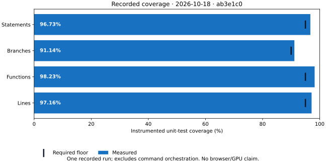

# Visual documentation

Start with what the reader needs to understand or decide, then choose a format. Use a visual for a comparison, relationship, sequence or measured result; keep short instructions and exact commands as text. The owning documentation page stays authoritative.

## Choose the format before the tool

These are options, not required tools. Prefer tools contributors already use. Excalidraw is one editable-diagram option; another editor or an editable SVG can be equally suitable.

| Need                                              | Format / tool example                                 | Real example here                                                                                                                        |
| ------------------------------------------------- | ----------------------------------------------------- | ---------------------------------------------------------------------------------------------------------------------------------------- |
| Options, capabilities or support                  | Markdown table                                        | [Browser/device matrix](../agents/browser-device-coverage.md#declare-the-supported-matrix)                                               |
| Small flow, sequence or relationship              | Mermaid in Markdown                                   | [Engineering workflow](../README.md#read-first)                                                                                          |
| Richer workflow, architecture or annotated sketch | Editable diagram and rendered export; e.g. Excalidraw | [Workflow SVG](workflow.svg) and [editable source](workflow.excalidraw)                                                                  |
| Overview or reusable illustration                 | Editable vector graphic                               | [Six highlights](template-highlights.svg), [source](template-highlights.excalidraw) and [stacked layout](template-highlights-narrow.svg) |
| Measurements, trends or benchmarks                | Chart from data and a plotting script                 | [Recorded coverage](#measured-chart)                                                                                                     |
| Actual UI or observed bug                         | Screenshot of the running application                 | [Starter capture](#actual-ui-capture)                                                                                                    |

The table, Mermaid workflow and workflow source/SVG predate this guide; the other examples are new. Capability diagrams describe available paths, not passed hardware tests.

## A starting look and feel

Use a small palette, readable type, short labels, consistent icons and generous spacing. Combine colour with labels or shapes. Check documentation and narrow-screen widths; stack or supply text when shrinking loses meaning. The [README highlights](../../README.md#six-highlights) use a responsive image plus the six text bullets.

Adapt this optional palette to the project's identity; it is not template branding:

Copyable colours and text alternative

| Role                   | Colour                |
| ---------------------- | --------------------- |
| Canvas                 | `#F8FAFC` or white    |
| Main / secondary text  | `#0F172A` / `#475569` |
| Agent work             | `#1971C2`             |
| Verification           | `#2F9E44`             |
| Owner approval         | `#C05621`             |
| Hardware routes        | `#0F766E`             |
| Application foundation | `#7C3AED`             |

Use useful alt text and nearby prose or a data table for important information. Keep fonts/assets portable and retain third-party licences. The new overview icons are original shapes; the palette SVG is editable source itself.

## Edit sources and exports together

- **Tables:** edit Markdown and check the rendered alignment and meaning. Keep capability claims separate from observed results.
- **Mermaid:** edit the fenced block in [the engineering index](../README.md). GitHub renders it; preview with a compatible Markdown viewer or [Mermaid's renderer](https://mermaid.js.org/config/usage.html). The block was verified locally with Mermaid 11.12.1. Keep its source in Markdown without another committed export.
- **Editable diagrams:** open `.excalidraw` at [Excalidraw](https://excalidraw.com), edit, save the source and export SVG with a background. Update matching files together. The highlights use Excalidraw 0.18.0's actual [export API](https://docs.excalidraw.com/docs/@excalidraw/excalidraw/api/utils/export). Both SVGs embed editable scenes; reopen the narrow SVG to change its stacked layout. Synchronize both layouts with the README bullets. Older SVGs were drawn from the same descriptions as their sources; editor exports can differ. The workflow source was also verified through the exporter.
- **Vector graphics:** edit the SVG directly or use a suitable editor. Preserve the viewBox, labels and text alternatives; an export should display without an editor account.

### Measured chart

This is one **2026-10-18** local gate run at `ab3e1c0` (38 files, 298 tests), not a live dashboard. Coverage excludes command orchestration and browser entry points; it establishes neither browser/GPU acceptance nor performance. [Input data](coverage-example.json) retains counts, floors, command, revision and scope.

With Python and Matplotlib 3.10.7 available in an optional environment, run `python engineering/diagrams/coverage-example.py` from the repository root. The [script](coverage-example.py) writes the SVG beside its input; it is not part of the gate. Update the data and provenance when recording another run, then regenerate. Windows may use `py` instead of `python`. Plotting tools are not project dependencies.

### Actual UI capture

[Capture metadata](starter-example.json) records revision, date, browser, host, viewport, API identities, native readback and painted-image counts, including whether the tree was dirty. The image shows the actual production preview with both APIs rendering; it is not a mockup. These are observations of that capture, not a performance or cross-browser guarantee. WSL/translated, native and software results must remain distinct.

The current capture was generated on 2026-10-18 by the tracked script at `e44ae6f`, in a clean native Windows checkout driving Chrome 155.0.8059.82 against the matching production preview. Both application renderers identified NVIDIA hardware and passed native readback and compositor checks. The PNG and JSON are the script's unmodified outputs; no separate capture harness or alternate metadata schema is needed.

On a host with both APIs available, install through `pnpm test:browser:install`, run `pnpm build` and start `pnpm preview --host 127.0.0.1 --port 4173 --strictPort`. In another terminal, run `node engineering/diagrams/capture-starter.mjs`. The [script](capture-starter.mjs) uses the existing GPU discovery/ownership lock, connects to its verified browser, pauses motion through the reduced-motion preference, asserts the greeting and both actual native/painted canvas outputs, then writes the PNG/metadata. It runs headless or on discovery's private display and releases its owned browser/lock in cleanup. It refuses a capture missing either rendered panel; use [GPU discovery](../agents/browser-gpu-discovery.md) to diagnose availability. Run natively on Windows for native Windows evidence; a Linux browser on WSL remains translated evidence. A separately driven native capture must retain equivalent checks and record its method and limits in the metadata. Stop the owned preview afterwards. Follow the [shared-machine rules](../agents/working-style.md#sharing-the-machine); a screenshot does not replace browser or accessibility tests.

## Review and maintenance

Keep visuals with their owning documentation; update source, export, text equivalent and evidence together. Check clarity, narrow-screen readability, contrast and agreement with the text in review. The existing link check covers Markdown targets; inspect HTML picture sources too. Add automation for concrete failures when justified, not a required editor, graphics pipeline or illustration on every page. No drawing/plotting package is added to the application or gate for these examples.

## Existing diagrams

| Diagram                 | Shows                          | Embedded in                         |
| ----------------------- | ------------------------------ | ----------------------------------- |
| `workflow`              | Issue to merged change         | Getting started                     |
| `guardrails`            | Four verification layers       | Getting started, local verification |
| `issue-statuses`        | Project statuses               | Issue tracker                       |
| `browser-device-matrix` | Desktop, device and farm paths | Browser/device coverage             |

## Browser matrix artwork

The coverage matrix is a map of available paths, not a record of passed tests.
Its text counterpart and evidence requirements are in
[browser and device coverage](../agents/browser-device-coverage.md).

Chrome, Edge, Firefox, Windows, Linux, Apple and Android icons come from
[Font Awesome Free / Fonticons, Inc.](https://github.com/FortAwesome/Font-Awesome/tree/14c65a3747d0f3b751f15831fc719236aea8729d/svgs/brands),
under [CC BY 4.0](https://creativecommons.org/licenses/by/4.0/), as specified in
the [upstream license](https://github.com/FortAwesome/Font-Awesome/blob/14c65a3747d0f3b751f15831fc719236aea8729d/LICENSE.txt).
They are scaled and colored for this diagram; WSL combines the Windows and Linux
symbols. The [WebKit logo](https://github.com/WebKit/WebKit/blob/65e33c5b374283583803361d22c7576c8e2ad83d/Websites/webkit.org/wp-content/themes/webkit/images/webkit.svg)
retains its upstream copyright notice: Copyright © 2025 Apple Inc. All rights
reserved. Its display-P3 colors are converted to sRGB for portable SVG rendering.
The phone/tablet outlines are original diagram shapes. Marks identify test targets.
