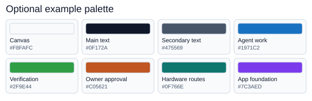

# Visual documentation

Start with what the reader needs to understand or decide, then choose a format. Use a visual for a comparison, relationship, sequence or measured result; keep short instructions and exact commands as text. The owning documentation page stays authoritative.

## Choose the format before the tool

These are options, not required tools. Prefer tools contributors already use. Excalidraw is one editable-diagram option; another editor or an editable SVG can be equally suitable.

| Need                                              | Format / tool example                                 | Example or guidance here                                                                                                                 |
| ------------------------------------------------- | ----------------------------------------------------- | ---------------------------------------------------------------------------------------------------------------------------------------- |
| Options, capabilities or support                  | Markdown table                                        | [Browser/device matrix](../agents/browser-device-coverage.md#declare-the-supported-matrix)                                               |
| Small flow, sequence or relationship              | Mermaid in Markdown                                   | [Engineering workflow](../README.md#read-first)                                                                                          |
| Richer workflow, architecture or annotated sketch | Editable diagram and rendered export; e.g. Excalidraw | [Workflow SVG](workflow.svg) and [editable source](workflow.excalidraw)                                                                  |
| Overview or reusable illustration                 | Editable vector graphic                               | [Six highlights](template-highlights.svg), [source](template-highlights.excalidraw) and [stacked layout](template-highlights-narrow.svg) |
| Measurements, trends or benchmarks                | Chart from data and a plotting script                 | [Measured charts](#measured-charts)                                                                                                      |
| Actual UI or observed bug                         | Screenshot of the running application                 | [Starter capture](#actual-ui-capture)                                                                                                    |

Capability diagrams describe available paths, not passed hardware tests. Measured charts use the project's own results.

## A starting look and feel

Use a small palette, readable type, short labels, consistent icons and generous spacing. Combine colour with labels or shapes. Check documentation and narrow-screen widths; stack or supply text when shrinking loses meaning. The [README highlights](../../README.md#six-highlights) use a responsive image plus the six text bullets.

Adapt this optional palette to the project's identity; it is not template branding:

Copyable colours and text alternative

| Role                   | Colour                |
| ---------------------- | --------------------- |
| Canvas                 | `#F8FAFC` or white    |
| Main / secondary text  | `#0F172A` / `#475569` |
| Agent work             | `#1971C2`             |
| Verification           | `#2F9E44`             |
| Owner approval         | `#C05621`             |
| Hardware routes        | `#0F766E`             |
| Application foundation | `#7C3AED`             |

Use useful alt text and nearby prose or a data table for important information. Keep fonts/assets portable and retain third-party licences. The new overview icons are original shapes; the palette SVG is editable source itself.

## Edit sources and exports together

- **Tables:** edit Markdown and check the rendered alignment and meaning. Keep capability claims separate from observed results.
- **Mermaid:** edit the fenced block in [the engineering index](../README.md). GitHub renders it; preview with a compatible Markdown viewer or [Mermaid's renderer](https://mermaid.js.org/config/usage.html). The block was verified locally with Mermaid 11.12.1. Keep its source in Markdown without another committed export.
- **Editable diagrams:** open `.excalidraw` at [Excalidraw](https://excalidraw.com), edit, save the source and export SVG with a background. Update matching files together. The highlights use Excalidraw 0.18.0's actual [export API](https://docs.excalidraw.com/docs/@excalidraw/excalidraw/api/utils/export). Both SVGs embed editable scenes; reopen the narrow SVG to change its stacked layout. Synchronize both layouts with the README bullets. Older SVGs were drawn from the same descriptions as their sources; editor exports can differ. The workflow source was also verified through the exporter.
- **Vector graphics:** edit the SVG directly or use a suitable editor. Preserve the viewBox, labels and text alternatives; an export should display without an editor account.

The [README agent workflow](../../README.md#how-the-agent-workflow-fits-together) uses directly editable SVG: [wide layout](agent-workflow.svg) and [stacked layout](agent-workflow-narrow.svg). Both files are their own source; edit them together with the README text equivalent. The wide layout groups context on the left, the agent with optional review and human gates in the center, and individual verification layers on the right. The stacked layout preserves those relationships on narrow screens. The palette matches the README highlights: slate text, a light slate canvas, white cards, blue agent work, green verification and orange owner approval. Thin borders and compact cards preserve the presentation layout. Review is owner-requested, skills run only when named, and local browser evidence is separate from the automated code/build gate. The overview describes the existing workflow; it does not establish a passed check or hardware test.

The [README GitHub workflow](../../README.md#through-github-issues-projects-and-pull-requests) also has directly editable [wide](github-workflow.svg) and [stacked](github-workflow-narrow.svg) sources, using the same palette. It follows one issue through Project statuses and connects them to the parent epic, labels, Priority, local worktree, pull request, checks, preview app, owner authorization and cleanup. Both workflow diagrams use original robot icons for work an agent can carry out or receive by delegation, and person icons for owner decisions or hands-on review. Drafting issues and updating the Project can be delegated; the owner decides scope and Priority and authorizes the exact merge head. A green build can publish a preview when `pnpm setup:previews` has been completed; the illustrated app windows show where to open and try the change. Keep both layouts, legends and README text equivalents synchronized with the issue tracker, task lifecycle and deployment guide. In the wide GitHub diagram, Blocked sits beneath implementation with separate parallel pause/resume arrows; failed checks return through the gap between the PR and worktree. The schematics and app windows are illustrations, not live Project or application screenshots. Task commands update and read back Project fields rather than relying on automatic Status workflows.

The README also includes a schematic [Project board](project-board.svg) and [narrow layout](project-board-narrow.svg). These directly editable SVGs emphasize the six Status columns and use muted bars for card contents, without task text or metadata. Compact cards and spacing keep the board brief; view/filter chips are omitted. Robot icons identify agent work. The configured Board view filters to open issues, so Done stays empty; the workflow diagram explains completion separately. Blocked retains its configured position before Done. The narrow layout reflows the columns into two per row and is selected up to 900px viewport width. Keep both layouts and the README explanation aligned with the issue tracker and hosted setup. The board is an abstract illustration, with no live issue data.

The [workload lifecycle](workload-lifecycle.svg), with its [editable Excalidraw source](workload-lifecycle.excalidraw), starts with competing agents sharing CPU, memory, disk and GPU resources, then shows normal execution, cancellation and supervisor-crash recovery. Its central distinction is that a free OS lock does not prove previous work has finished. The [owning guide and text equivalent](../agents/workload-coordination.md#reservation-lifecycle) define workloads, their place in agentic development, adoption, the supported process boundary and safe recovery. The SVG is an Excalidraw 0.18.0 export with an embedded editable scene, a white background and accessible title/description. Both wide/narrow agent and GitHub overview graphics mark local verification as sharing a slot, with planning/editing concurrent and CI separate. Update sources, exports and text together; check both full-size and narrow previews. These describe behavior, not a live process inventory or evidence that any platform passed verification.

### Measured charts

Use the project's own measurements. Keep the source data, generating script and rendered chart together, with the command, date, tested revision, environment, metric definitions, exclusions and limitations. Show thresholds separately from observations and include readable labels plus a data table or text equivalent. A dated chart is a snapshot, not a live dashboard.

Choose an existing plotting tool in an optional environment; no plotting package is required by the application or gate. Document its version and regeneration command. For coverage charts, retain counts and denominators from the current `coverage/coverage-summary.json`, and explain the measured groups and exclusions from the [verification guide](../agents/local-verification.md). Coverage does not establish browser/GPU acceptance or performance. Update data and provenance together when recording another run, then regenerate the chart.

### Actual UI capture

[Capture metadata](starter-example.json) records revision, date, browser, host, viewport, API identities, native readback and painted-image counts, including whether the tree was dirty. The image shows the actual production preview with both APIs rendering; it is not a mockup. These are observations of that capture, not a performance or cross-browser guarantee. WSL/translated, native and software results must remain distinct.

The current capture was generated on 2026-10-18 by the tracked script at `e44ae6f`, in a clean native Windows checkout driving Chrome 155.0.8059.82 against the matching production preview. Both application renderers identified NVIDIA hardware and passed native readback and compositor checks. The PNG and JSON are the script's unmodified outputs; no separate capture harness or alternate metadata schema is needed.

On a host with both APIs available, install through `pnpm test:browser:install`, run `pnpm build` and start `pnpm preview --host 127.0.0.1 --port 4173 --strictPort`. In another terminal, run `node engineering/diagrams/capture-starter.mjs`. The [script](capture-starter.mjs) uses the existing GPU discovery/ownership lock, connects to its verified browser, pauses motion through the reduced-motion preference, asserts the greeting and both actual native/painted canvas outputs, then writes the PNG/metadata. It runs headless or on discovery's private display and releases its owned browser/lock in cleanup. It refuses a capture missing either rendered panel; use [GPU discovery](../agents/browser-gpu-discovery.md) to diagnose availability. Run natively on Windows for native Windows evidence; a Linux browser on WSL remains translated evidence. A separately driven native capture must retain equivalent checks and record its method and limits in the metadata. Stop the owned preview afterwards. Follow the [shared-machine rules](../agents/working-style.md#sharing-the-machine); a screenshot does not replace browser or accessibility tests.

## Review and maintenance

Keep visuals with their owning documentation; update source, export, text equivalent and evidence together. Check clarity, narrow-screen readability, contrast and agreement with the text in review. The existing link check covers Markdown targets; inspect HTML picture sources too. Add automation for concrete failures when justified, not a required editor, graphics pipeline or illustration on every page. No drawing/plotting package is added to the application or gate for these examples.

## Existing diagrams

| Diagram                 | Shows                          | Embedded in                         |
| ----------------------- | ------------------------------ | ----------------------------------- |
| `workflow`              | Issue to merged change         | Getting started                     |
| `agent-workflow`        | Context to approved change     | Repository README                   |
| `github-workflow`       | Issue, Project and PR delivery | Repository README                   |
| `project-board`         | Status columns and task cards  | Repository README                   |
| `guardrails`            | Four verification layers       | Getting started, local verification |
| `workload-lifecycle`    | Reservation and crash recovery | Workload coordination guide         |
| `issue-statuses`        | Project statuses               | Issue tracker                       |
| `browser-device-matrix` | Desktop, device and farm paths | Browser/device coverage             |

## Browser matrix artwork

The coverage matrix is a map of available paths, not a record of passed tests.
Its text counterpart and evidence requirements are in
[browser and device coverage](../agents/browser-device-coverage.md).

Chrome, Edge, Firefox, Windows, Linux, Apple and Android icons come from
[Font Awesome Free / Fonticons, Inc.](https://github.com/FortAwesome/Font-Awesome/tree/14c65a3747d0f3b751f15831fc719236aea8729d/svgs/brands),
under [CC BY 4.0](https://creativecommons.org/licenses/by/4.0/), as specified in
the [upstream license](https://github.com/FortAwesome/Font-Awesome/blob/14c65a3747d0f3b751f15831fc719236aea8729d/LICENSE.txt).
They are scaled and colored for this diagram; WSL combines the Windows and Linux
symbols. The [WebKit logo](https://github.com/WebKit/WebKit/blob/65e33c5b374283583803361d22c7576c8e2ad83d/Websites/webkit.org/wp-content/themes/webkit/images/webkit.svg)
retains its upstream copyright notice: Copyright © 2025 Apple Inc. All rights
reserved. Its display-P3 colors are converted to sRGB for portable SVG rendering.
The phone/tablet outlines are original diagram shapes. Marks identify test targets.
